# HydroStar MCP

**简体中文**　[English](README.en.md)

从参数、型值表和 CAD 建立水动力模型，完成面元质量检查、静力平衡、HydroStar 原生求解与六自由度结果验收。项目面向研究生课程、方法研究及明确假设下的工程简化分析，提供 Windows 本地 MCP 和命令行接口。

[在线计算报告](https://lightninnng.github.io/hydrostar-mcp/)可旋转实际求解网格，切换构型、浪向、幅值、相位及动态场量。[快速开始](docs/quickstart.md)介绍安装与复算，[建模说明](docs/modeling-guide.md)给出参数和质量要求。

[复杂建模展示](#多来源复杂几何与网格)另提供贯通月池浮体、曲线站位船体及带升沉板 Spar 的网格与响应图，[在线报告对应章节](https://lightninnng.github.io/hydrostar-mcp/#geometry-heading)可逐项查看。

## 计算对象与求解网格

曲线船体由本项目原创型值表重建，采用沿站位与剖面的四边形网格带。湿面包含 2018 个四边形和 11 个端部三角形，另有 844 个水线面元，全体合计 **2873 个面元**。在默认预算内完成 **231 个频率点和 13 个浪向**的真实计算，几何与六项原生执行门禁全部通过。

以下为 HydroStar 自带 **Visu5D** 直接打开实际求解 HST 后保存的湿面网格原图。点击任一图片可看完整分辨率。[来源、导出步骤与哈希](examples/visualization/viewer-exports.json)随算例保存。

| 原创曲线船体 | 半潜平台 |
| --- | --- |
| [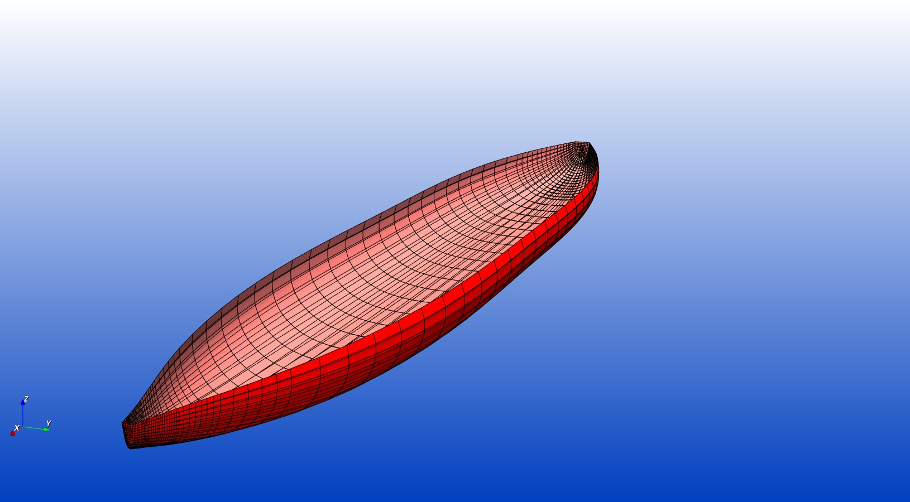](docs/assets/vessel_visu5d.jpg) | [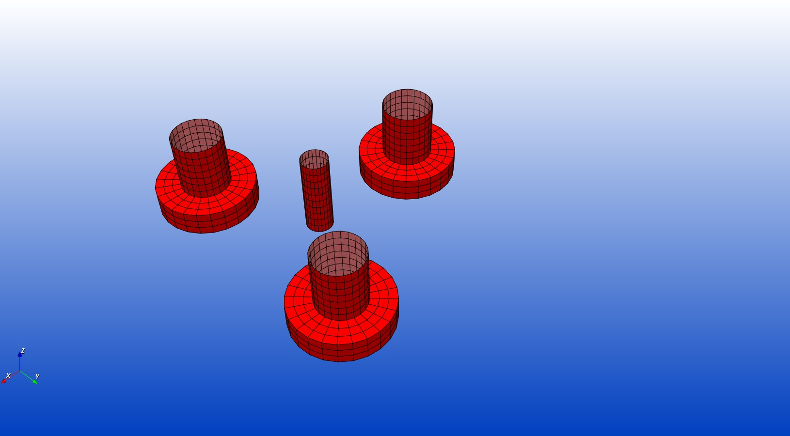](docs/assets/platform_visu5d.jpg) |
| **集装箱船** | **丰满油船** |
| [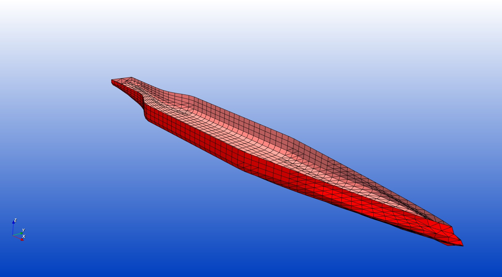](docs/assets/container_visu5d.jpg) | [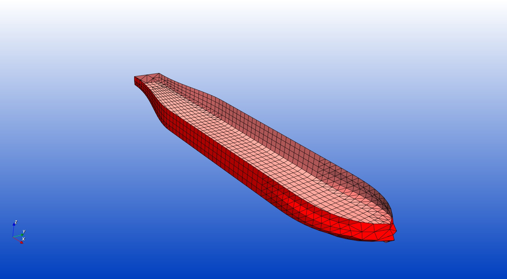](docs/assets/tanker_visu5d.jpg) |

查看 ParaView 配套总览（含平台干结构与细杆背景）

[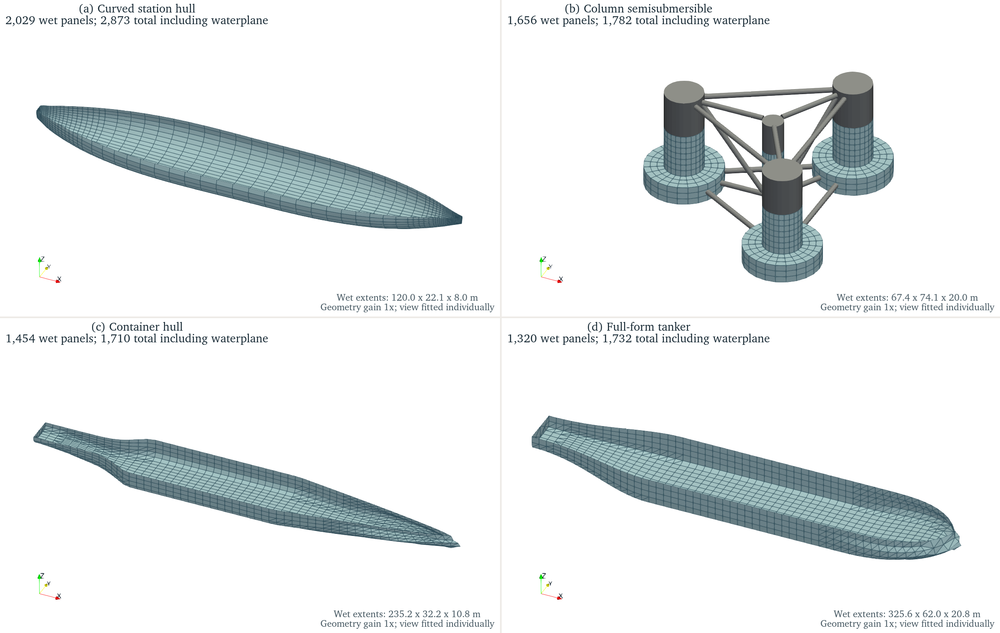](docs/assets/readme-meshes.png)

蓝色为势流湿表面，灰色为平台干结构和细杆背景。几何倍率为 1，各视图独立取景。

| 计算对象 | 全体总面元，含水线面 | 频率范围与间隔（rad/s） | 频率点与浪向数 |
| --- | --- | --- | --- |
| [原创曲线船体](examples/vessel) | 2873 | 0.05–1.20，0.005 | 231 × 13 |
| [集装箱船](examples/results/container_kcs_style) | 1710 | 0.05–0.80，0.005 | 151 × 13 |
| [丰满油船](examples/results/tanker_kvlcc2_style) | 1732 | 0.05–0.60，0.005 | 111 × 13 |
| [半潜平台](examples/results/semisub_oc4_style) | 1782 | 0.02–1.20，0.005 | 237 × 13 |

三类资料参照构型使用公开主尺度与本项目明确的形状假设，节点和面元由项目生成器建立。[来源说明](docs/reference-forms.md)保存了尺度引用、重建方法与物理模型。

展示图按生成工具标注。月池网格首图是 Visu5D 自带查看器直接保存的原生软件图；ParaView、Gnuplot 生成的图为配套工具出图，分别保留 HydroStar 原生数值来源。

## 压力、波面与运动静态图

四种构型均提供表面压力、总波面和散射波面的同相位静态原图。共同入射波幅为 **0.50 m**，浪向为 **60°**；各自选定频率、物理周期和水深如下。

| 计算对象 | 角频率（rad/s） | 物理周期（s） | 水深（m） |
| --- | --- | --- | --- |
| 曲线船体 | 0.65 | 9.666 | 80 |
| 半潜平台 | 0.80 | 7.854 | 200 |
| 集装箱船 | 0.50 | 12.566 | 80 |
| 丰满油船 | 0.40 | 15.708 | 80 |

下方三联配套图的左图显示平均湿表面的随体一阶动态压力（kPa），中图为总波面与刚体运动，右图为包含绕射和运动诱导辐射的散射波面（m）。运动和波高各采用 6 倍观察倍率，压力图几何倍率为 1。各组三联图采用同一物理相位，色标在整个周期内固定。

**曲线船体。** 查看所选相位下船体湿面压力、总波面、散射波面与六自由度运动的对应关系。

[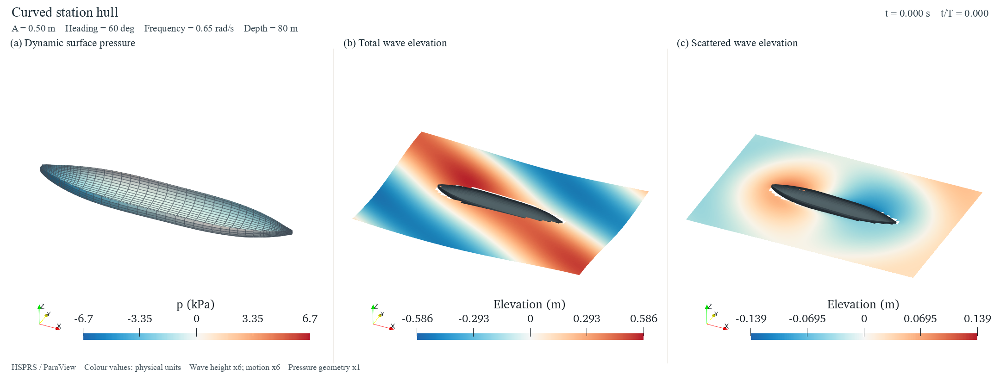](docs/assets/vessel-coupled-frame.png)

**半潜平台：HyView 湿面压力云图。** 在 HydroStar 自带 HyView 中回放 60°、周期 7.9 s、波幅 0.50 m、水深 200 m 的规则波，隐藏自由面后保存原生录制并提取静帧。颜色从紫到黄对应 −0.56 至 +0.56 m 水柱（约 −5.63 至 +5.63 kPa）的显示范围。图中为随体一阶扰动压力；结构应力需另行计算。

[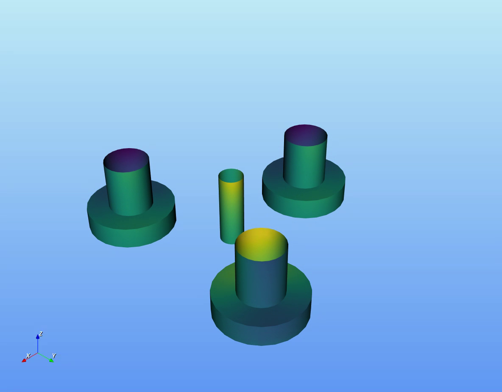](docs/assets/platform_pressure_hyview.png)

查看 ParaView 的压力、总波面与散射波面配套图

[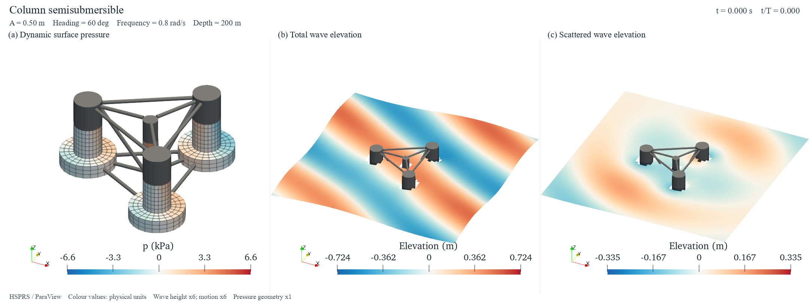](docs/assets/platform-coupled-frame.png)

**集装箱船。** 参照构型包含平行中体、圆舭、球鼻艏和艉封板，静图使用该构型自身的计算结果。

[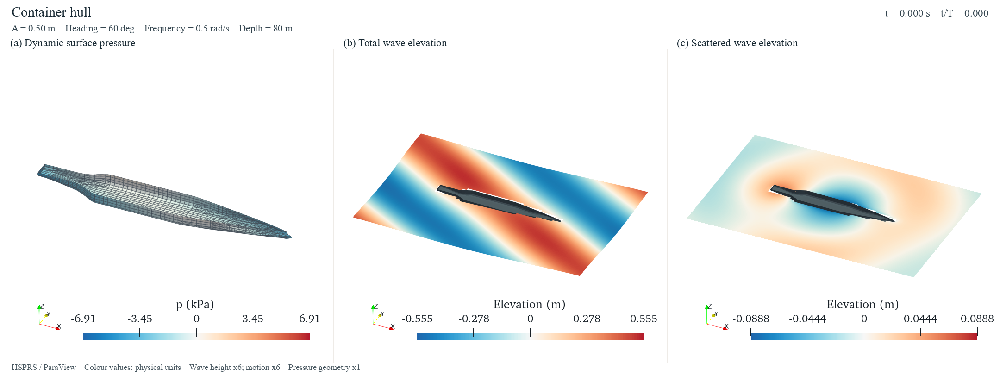](docs/assets/container-coupled-frame.png)

**丰满油船。** 展示丰满中体和连续收缩艏艉所对应的湿表面压力与外部波场。

[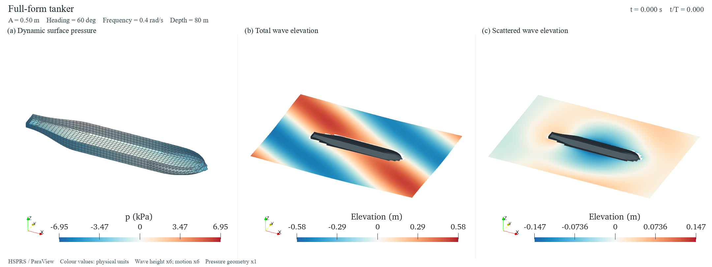](docs/assets/tanker-coupled-frame.png)

配套 ParaView 图标明 t、t/T、工况与固定色标，点击可查看原尺寸。HyView 静帧保留原生画面，其录制帧号和色标见[原生结果图验收记录](examples/visualization/result-viewer-exports.json)。这些图用于查看场量分布，全周期峰值另由完整数值确定。

## 绕射与辐射波场

以下静态原图将同一相位的散射波场分解为固定体绕射和运动诱导辐射。左图保持平均姿态，右图显示该工况六自由度运动激发的辐射贡献。分量在复数域分解后按统一物理相位重建，波面色标为 m，波高和运动观察倍率均为 6。每个面板在完整周期内采用固定色标。

**曲线船体的绕射与辐射。**

[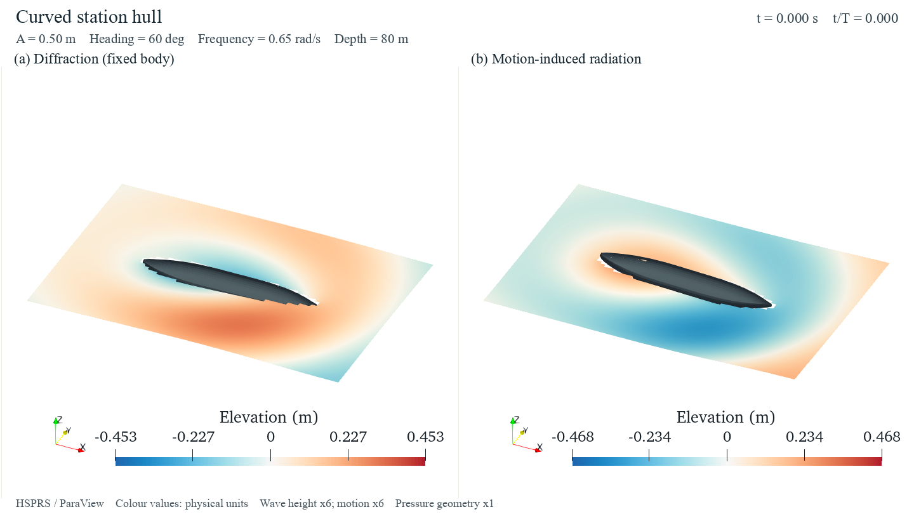](docs/assets/vessel-components-frame.png)

**半潜平台的绕射与辐射。**

[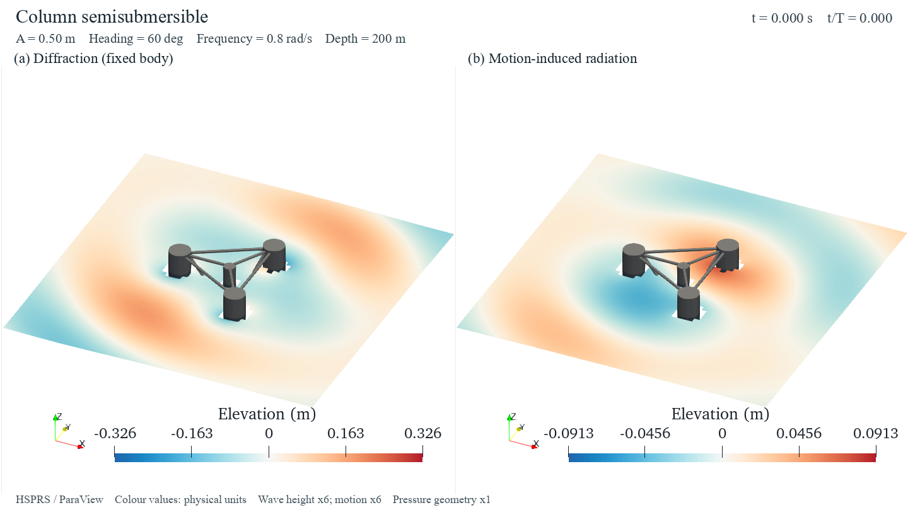](docs/assets/platform-components-frame.png)

**集装箱船的绕射与辐射。**

[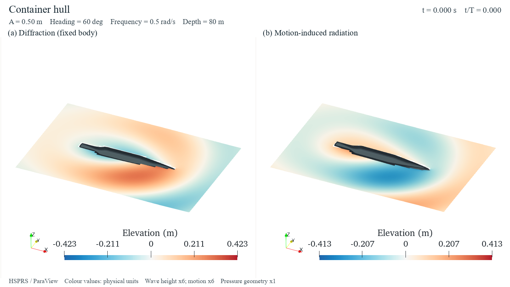](docs/assets/container-components-frame.png)

**丰满油船的绕射与辐射。**

[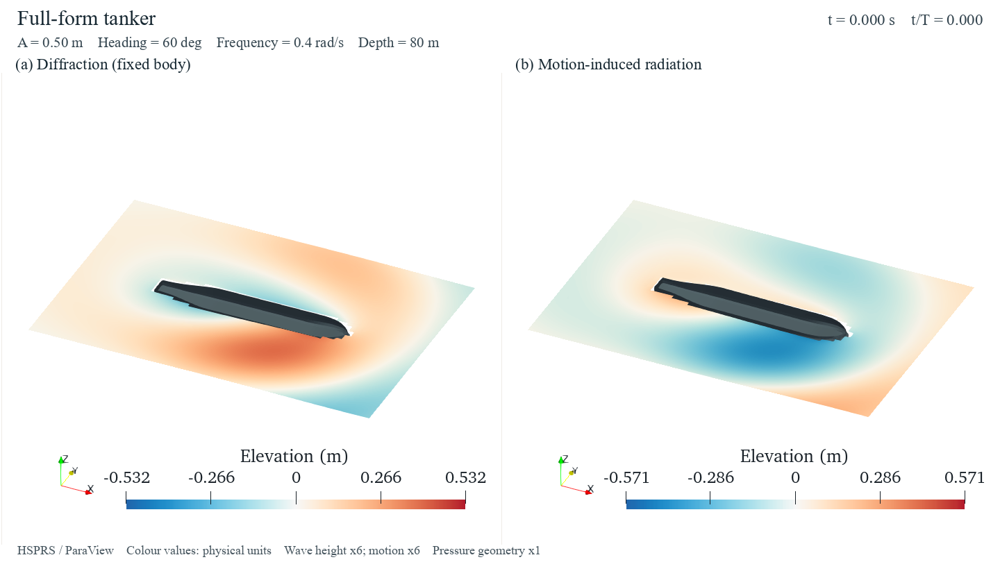](docs/assets/tanker-components-frame.png)

场量来自经独立核对的 HSPRS 原生复数结果，使用 ParaView 命令直接导出 PNG；图注排版与所选相位随导出记录保存。入射波解析解、完整复辐射重建、随体压力修正及外法向采样敏感性分别验收。HSprv 原始导出和版本兼容性诊断一并保存，展示字段明确指向已验收结果。[可视化数据与导出记录](examples/visualization)和[命令复现方法](docs/native-visualization.md)随仓库提供。单独放大的总波与散射波视图见[曲线船体](docs/assets/vessel-wave.gif)、[半潜平台](docs/assets/platform-wave.gif)、[集装箱船](docs/assets/container-wave.gif)和[丰满油船](docs/assets/tanker-wave.gif)。

已有动画（可选）

[曲线船体压力与波面](docs/assets/readme-vessel-coupled.gif) · [曲线船体绕射与辐射](docs/assets/readme-vessel-components.gif) · [半潜平台压力与波面](docs/assets/readme-platform-coupled.gif) · [半潜平台绕射与辐射](docs/assets/readme-platform-components.gif) · [集装箱船压力与波面](docs/assets/readme-container-coupled.gif) · [集装箱船绕射与辐射](docs/assets/readme-container-components.gif) · [丰满油船压力与波面](docs/assets/readme-tanker-coupled.gif) · [丰满油船绕射与辐射](docs/assets/readme-tanker-components.gif)

## 六自由度频率响应

六自由度为纵荡、横荡、升沉、横摇、纵摇和艏摇。横轴为角频率（rad/s），平移幅值单位为 m/m，转动为 deg/m。各例保留原生 RAO；Gnuplot 配套叠图通过核对 hsrao 宏与数据列导出，展示 0°、60°、90°、120° 和 180° 浪向。

**曲线船体。** 231 个频率点覆盖 0.05–1.20 rad/s，间隔为 0.005 rad/s，保留升沉、横摇与纵摇等响应的峰谷细节。

[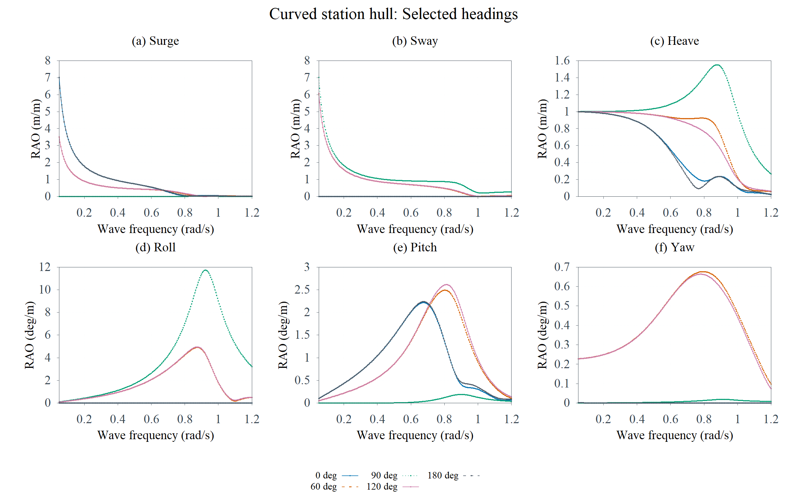](docs/assets/vessel-response.pdf)

**半潜平台：StarViewer 原生 RAO。** 用 HydroStar 自带 StarViewer 读取六个 `.rao`，直接保存 60° 浪向的六自由度幅值 SVG。237 个频率点覆盖 0.02–1.20 rad/s。

[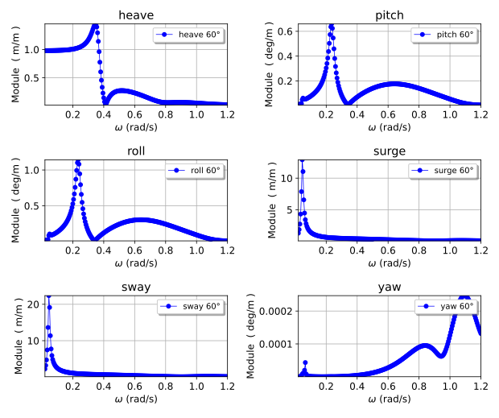](docs/assets/platform_rao_starviewer.svg)

[半潜平台五个浪向的 Gnuplot 配套 PDF](docs/assets/platform-response.pdf)。

**集装箱船。** 151 个频率点覆盖 0.05–0.80 rad/s。

[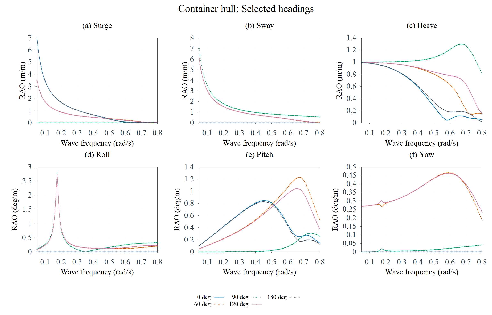](docs/assets/container-response.pdf)

**丰满油船。** 111 个频率点覆盖 0.05–0.60 rad/s。

[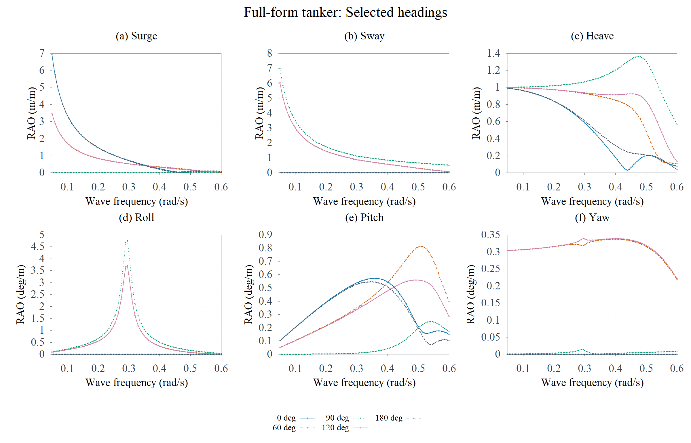](docs/assets/tanker-response.pdf)

查看曲线船体在 60° 浪向下的六自由度相位

相位单位为 deg，按 −180° 至 180° 包裹显示，跨边界采用离散点保留原生采样；相位跳变需结合包裹约定和相应幅值判断。

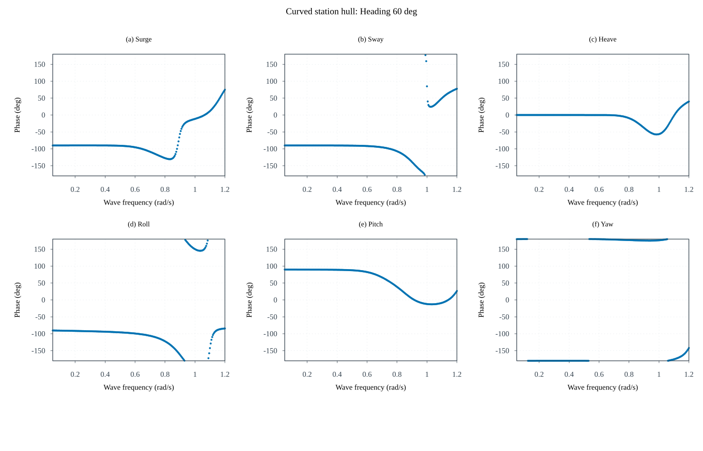

点击响应图打开对应的矢量原图。完整数值、13 个浪向的 SVG、物理参数及原生输入见[曲线船体算例](examples/vessel)、[其他三种构型结果](examples/results)和[Gnuplot 曲线与原始数据](examples/visualization/curves)。

## 二阶平均漂移与差频荷载

半潜平台已完成 **HSdft → HSamg → HSqtf** 原生二阶计算，提供平均漂移荷载及包含自由面积分的完整差频 QTF。水深为 200 m，浪向为 60°，差频为 0、0.05、0.10 rad/s，共保留 **36 对有效波频、216 个复数荷载系数**。

**同一构型的 HyView 带浪画面。** HSMCN 的一阶刚体运动与 HSPRS 自由面在 HyView 中一起回放。规则波周期 7.9 s（约 0.795 rad/s），波幅 0.50 m，浪向 60°。画面显示一阶波况与运动；实际二阶荷载见下方 QTF。

[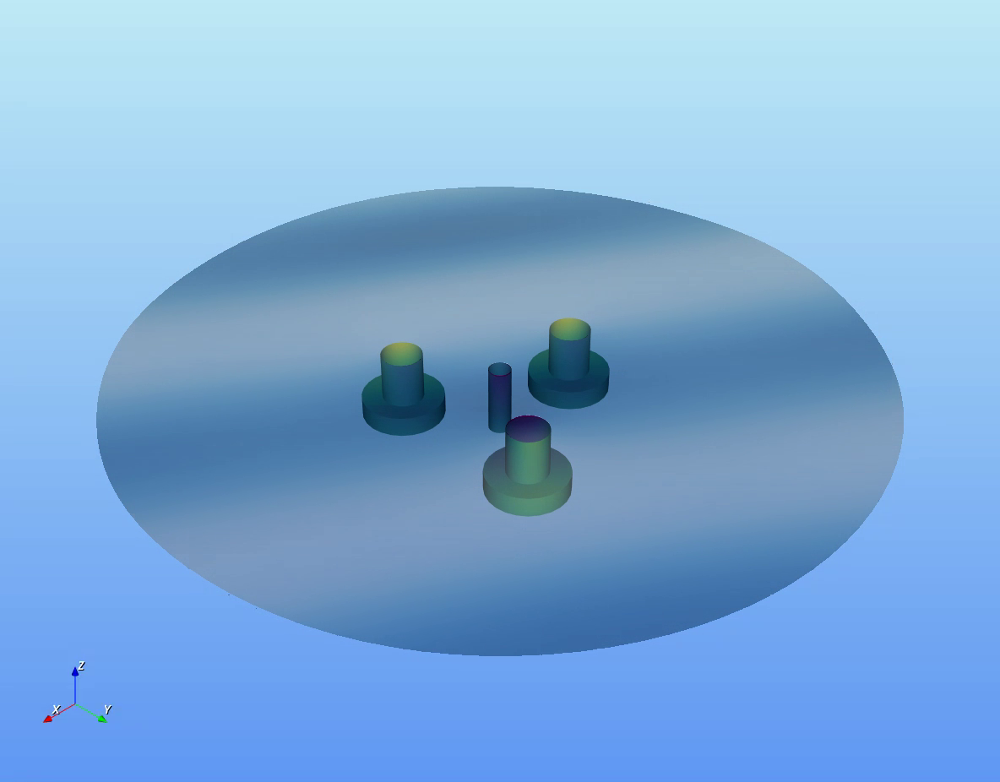](docs/assets/platform_wave_hyview.png)

**StarViewer 原生二阶垂向 QTF。** 读取 `qtf_fz.qtf`，显示三条差频幅值曲线，单位 N/m²。横轴为两波角频率的平均值，显示约 0.50–1.05 rad/s 的有效段。[图像来源与复算记录](examples/visualization/result-viewer-exports.json)。

[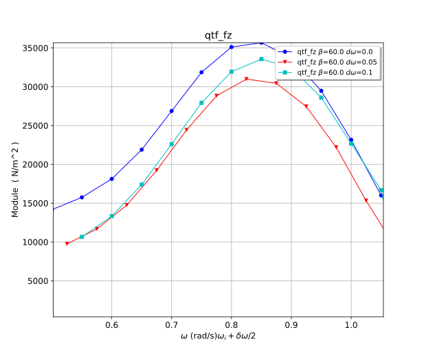](docs/assets/platform_qtf_fz_starviewer.svg)

[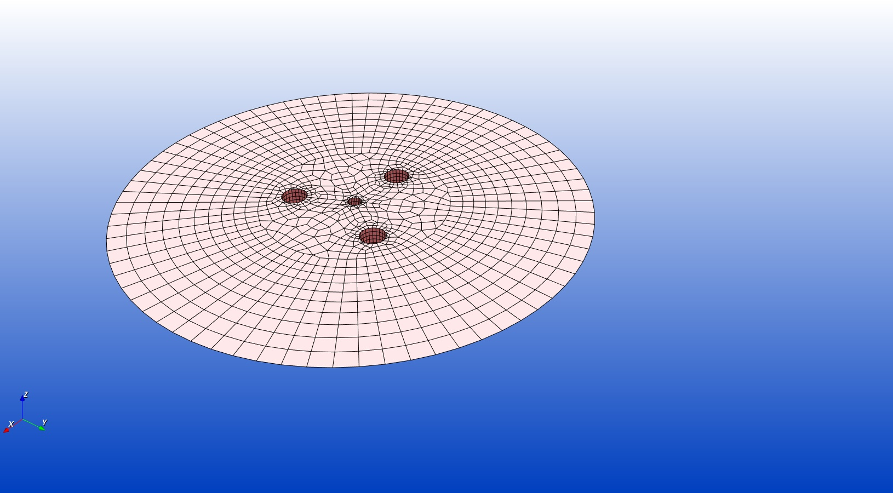](docs/assets/platform_exterior_visu5d.jpg)

Visu5D 从二阶求解 HST 读取 **Hull 1** 与 **Free-surface**；上图显示完整对称展开的外部积分网格，柱体位于自由面下方。

查看 ParaView 配套图中的湿面与积分域

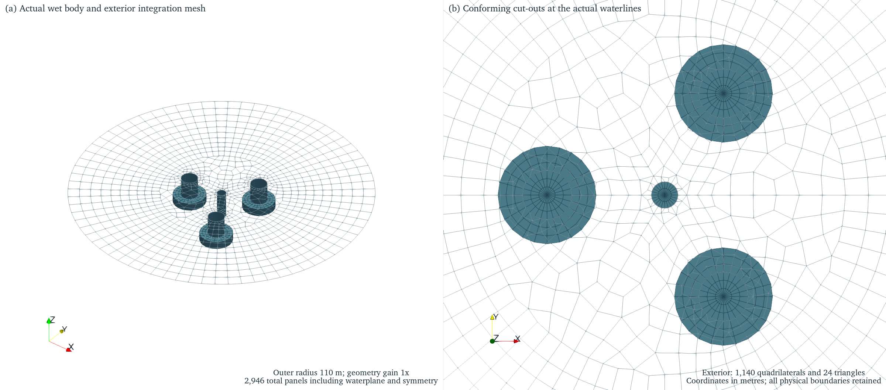

外部水域采用 72 个等角分段与 9 层渐变四边形环带，近体分区按平台对称性对应。主网格为 **2946 个全体总面元**，计入湿面、水线面、外部自由面和对称展开；对照为 2898。湿面、质量、惯性、恢复与阻尼保持一致，两档均重新完成原生计算。

[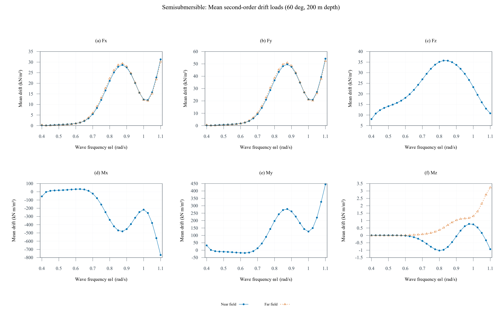](docs/assets/platform-second-order-drift.pdf)

[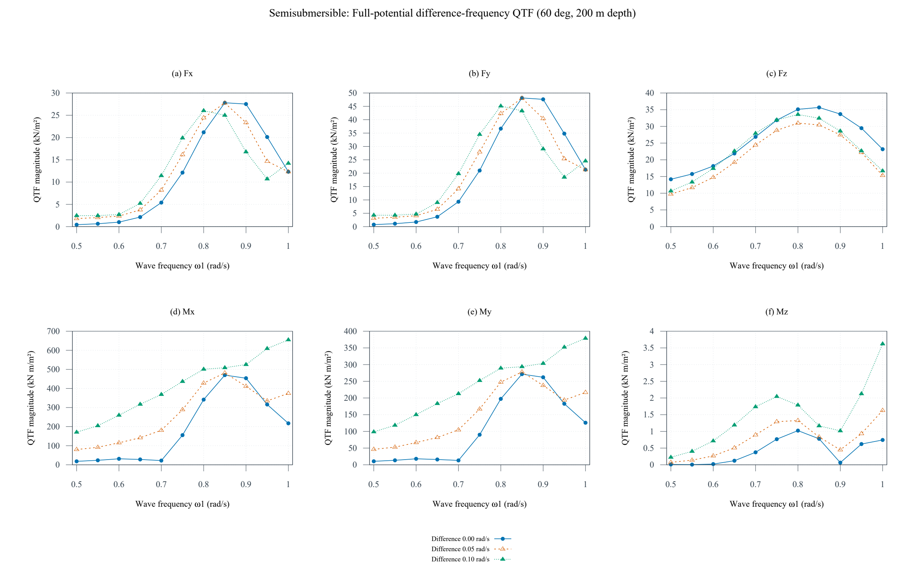](docs/assets/platform-second-order-qtf.pdf)

**二阶荷载系数的代表相位。** 下列静态图从已验收的原生复数 QTF 按 `q(t)=Re[Q exp(iΔωt)]` 重建相位。第一组以波频和差频为坐标，显示 36 对有效频率的六分量系数；第二组选取 ω₁=0.80、ω₂=0.90 rad/s，显示差频为 0.10 rad/s 的六分量谐波。

[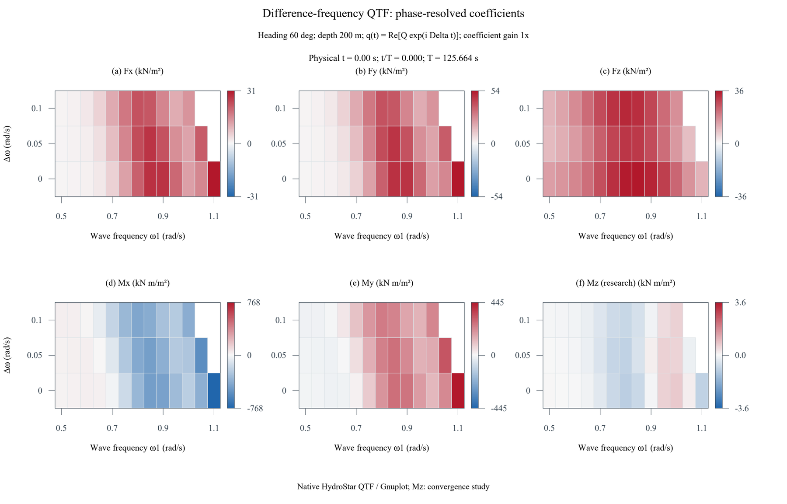](docs/assets/platform-second-order-map-frame.png)

[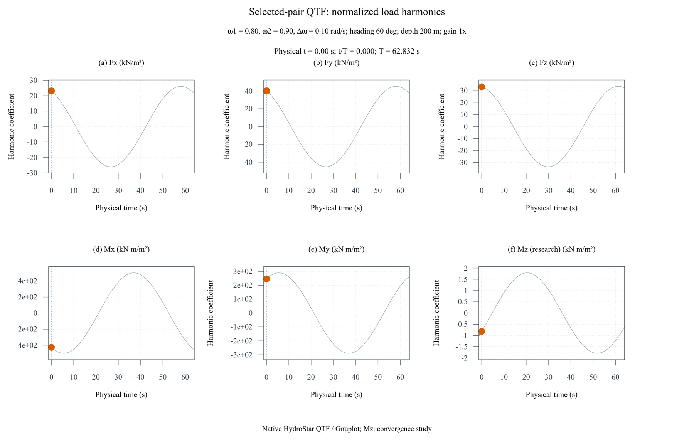](docs/assets/platform-second-order-harmonics-frame.png)

静图注明所选相位，对应物理周期分别为 125.664 s 和 62.832 s。已有的[相位云图动画](docs/assets/platform-second-order-map.gif)和[谐波动画](docs/assets/platform-second-order-harmonics.gif)作为可选资料保留。力系数为 kN/m²，力矩系数为 kN m/m²，色标与纵轴在整个周期内固定，系数倍率为 1。这些视图表达归一化二阶荷载系数的相位变化，实际双频总荷载组合、二阶表面压力和慢漂位移各需相应求解与验收。艏摇分量保留收敛研究标识。

力系数单位为 kN/m²，力矩系数为 kN m/m²；图中保留原生频率采样。QTF 对角项与平均漂移结果的最大归一差异为 0.032%，水平漂移力的近远场差异最高为 3.76%。两档外部积分离散的三个力分量复数差异最高为 0.41%，横摇和纵摇力矩最高为 0.083%。**艏摇力矩的自身峰值归一差异为 23.37%，近远场平均漂移差异为 128.85%，该分量标为需继续收敛研究，完成验证后再用于工程荷载。** 当前比较固定湿面与外部域半径，目标工程用途还需相应的空间、外部域、频率与参考结果证据。

查看复数 QTF 与积分网格敏感性

[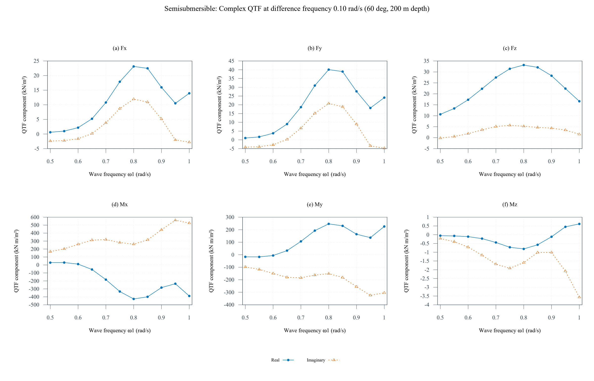](docs/assets/platform-second-order-complex.pdf)

[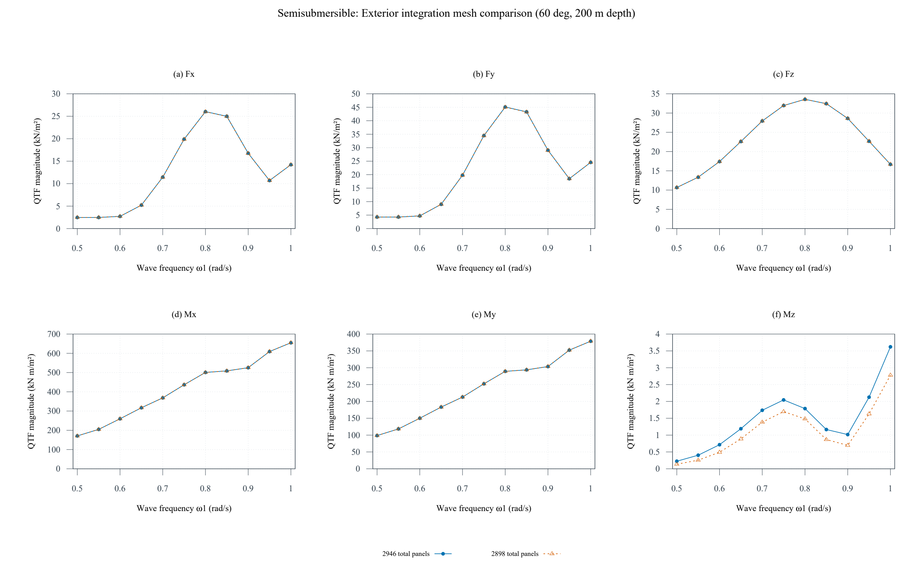](docs/assets/platform-second-order-sensitivity.pdf)

[二阶分析方法与复算](docs/second-order.md)说明积分域、频率配对和验收范围。[原生二阶计算包](examples/second-order/platform)保存 HST、RDF、MCN、DFT、QTF、RAO、八阶段日志、复数输出与正式交付清单；本例的 SPC 谱统计输入为本次不适用。四种构型的前述动态图展示各自的一阶压力、波场与运动。

## 多来源复杂几何与网格

以下三个原创算例展示曲线放样、贯通开口与 CAD 导入的完整建模链路。网格沿结构特征布置，保留实际求解 HST 中的四边形与局部三角形；各例已通过所列几何验收和六项原生执行门禁。

查看三个算例的 ParaView 配套网格总览

[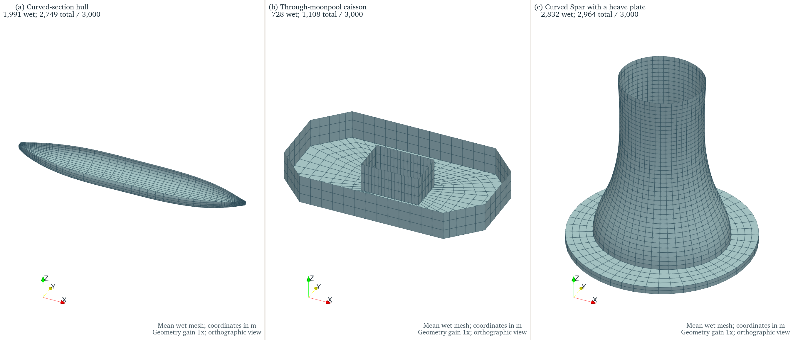](docs/assets/geometry-source-cases.pdf)

| 示例构型 | 面元布局 | 湿面四边形 / 三角形 | 全体总面元，含水线面 | CAD 体积相对差 |
| --- | --- | --- | --- | --- |
| [曲线站位船体](examples/geometry/lofted_vessel) | 站位与剖面网格带 | 1978 / 13 | 2749 | 0.490% |
| [贯通月池浮体](examples/geometry/moonpool_caisson) | 内外壁与底面相容分块 | 728 / 0 | 1108 | 小于 0.001% |
| [曲面 Spar 与升沉板](examples/geometry/cad_spar) | 轴向环带与径向分区 | 2832 / 0 | 2964 | 0.411% |

**当前展示和生成脚本均控制在 3000 个全体等效总面元内，包含湿面、水线面和对称展开。** 船体与 Spar 已按新网格重算，保持原有质量、重心、惯性、阻尼及环境；Spar 另保存 2916 个总面元的邻近离散，用于局部响应敏感性比较。

**带贯通月池的多边形浮体。** 由外部实体减去贯通开口，外壁、月池内壁和连接底面采用相容分块，保留内外水线闭环。

[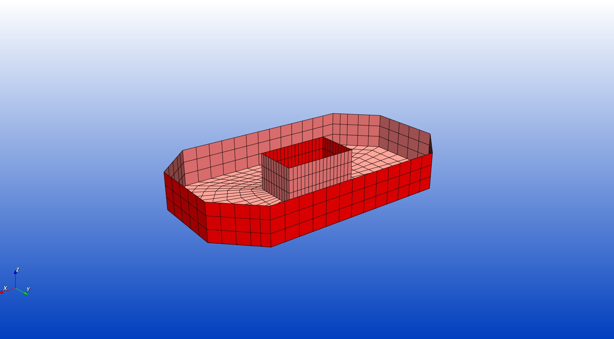](docs/assets/moonpool_caisson_visu5d.jpg)

三个复杂构型同样由 Visu5D 打开实际求解 HST，用 **Save image to file** 保存 JPG。[软件原图的来源与哈希](examples/visualization/viewer-exports.json)。

查看 ParaView 配套正交投影

[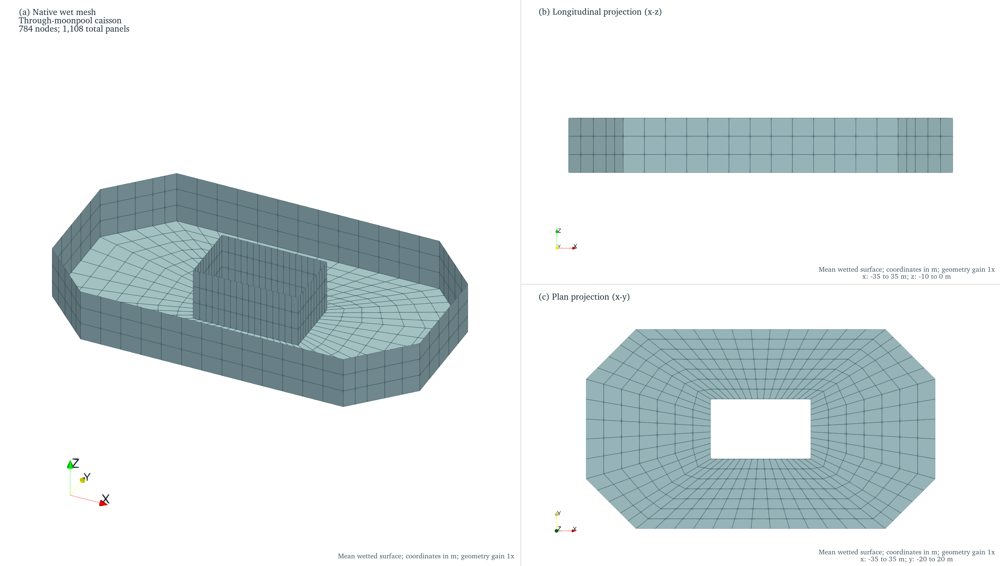](docs/assets/moonpool_caisson_geometry.pdf)

**曲线站位船体。** 由原创曲线站位资料放样，采用对应的纵向与剖面网格带；艏艉保留有记录的局部三角形过渡。

[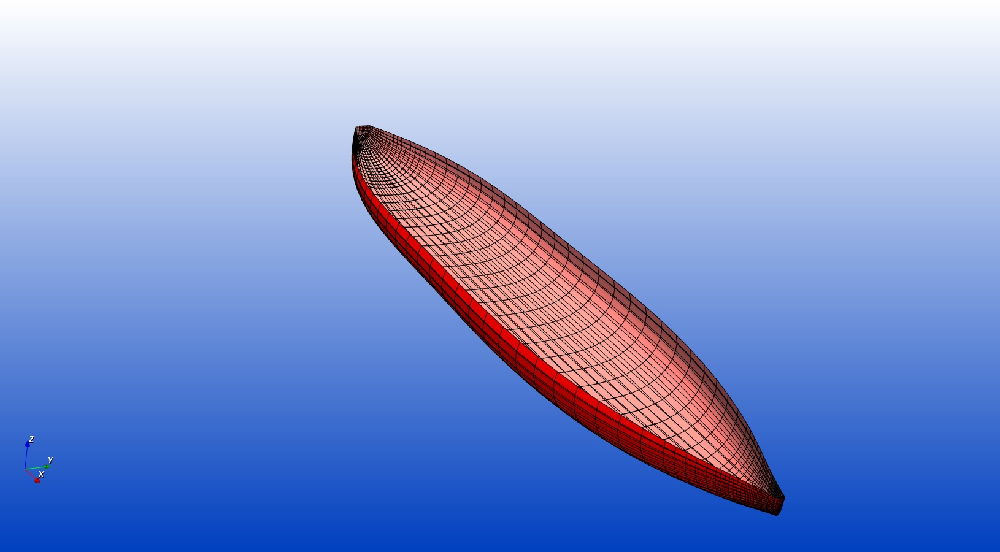](docs/assets/lofted_vessel_visu5d.jpg)

查看 ParaView 配套正交投影

[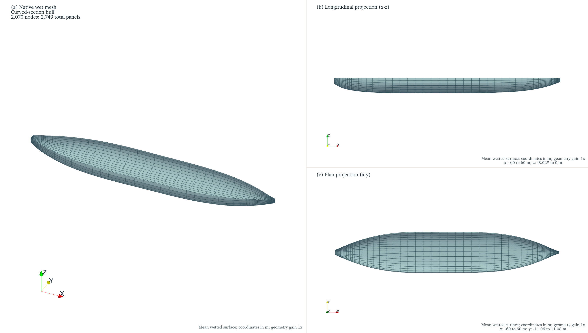](docs/assets/lofted_vessel_geometry.pdf)

**带升沉板的曲面 Spar。** 导入本项目构造的毫米制 STEP，完成单位转换与水线裁剪，柱体环带与有限厚升沉板的径向分区相接。

[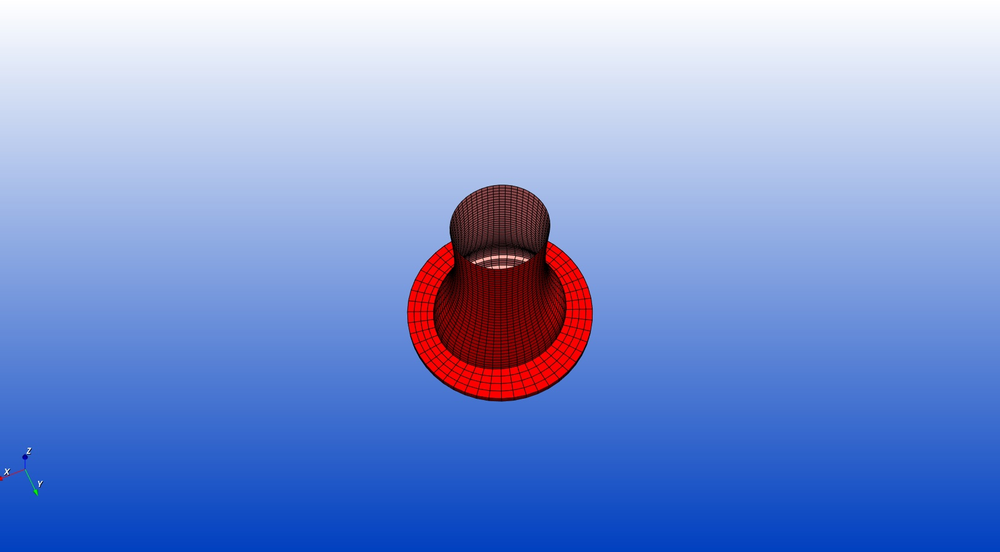](docs/assets/cad_spar_visu5d.jpg)

查看 ParaView 配套正交投影

[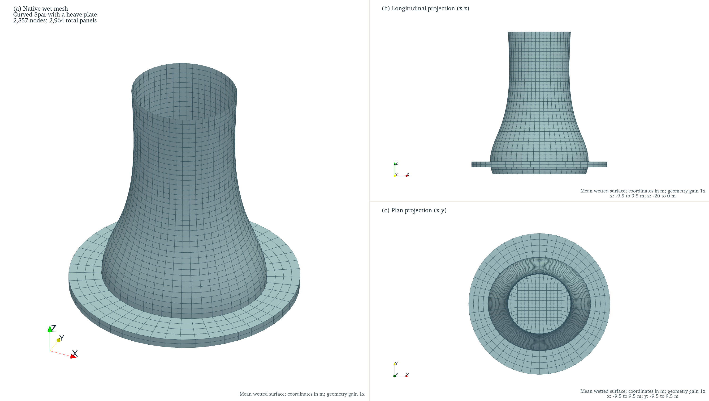](docs/assets/cad_spar_geometry.pdf)

网格总览和配套投影由 HSprv → ParaView 导出，并逐面核对交付 HST。配套单模型 PNG 为 3000×1700；各模型 PDF 分三页保存三维、纵向和俯视图，总览 PDF 每个模型一页。本机 ParaView 的三维 PDF 含高清位图。响应与网格对照曲线读取原始 RAO 和 hsrao 绘图宏，由 Gnuplot 导出矢量 PDF/SVG。坐标单位为 m，几何倍率为 1，各视图独立取景。[完整验收数据](examples/geometry/index.json)记录角度、翘曲、相邻尺度比、CAD 体积与浮心误差及来源哈希。

查看三个复杂几何算例的六自由度响应

响应覆盖 0.2–0.8 rad/s、间隔 0.1 rad/s，浪向为 0°、60°、120° 和 180°；平移响应单位为 m/m，转动为 deg/m。

[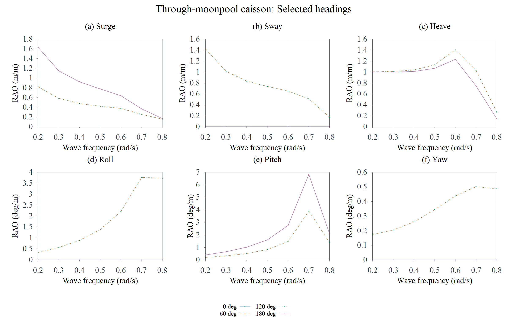](docs/assets/moonpool_caisson_rao.pdf)

[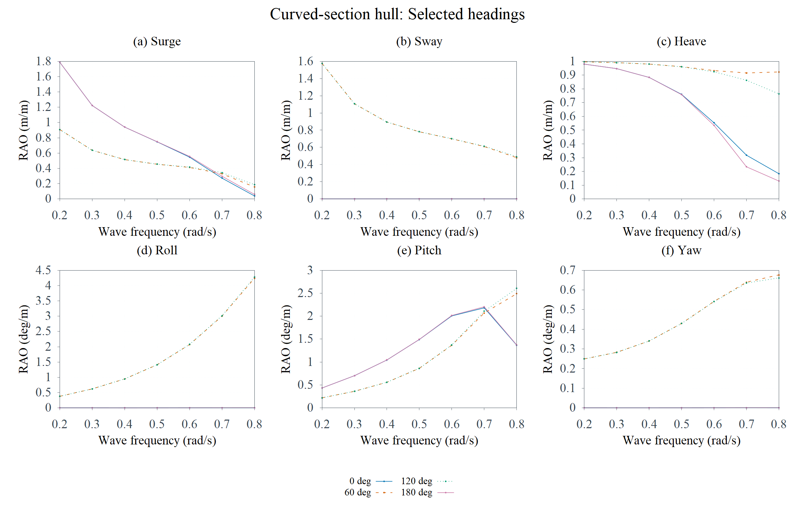](docs/assets/lofted_vessel_rao.pdf)

[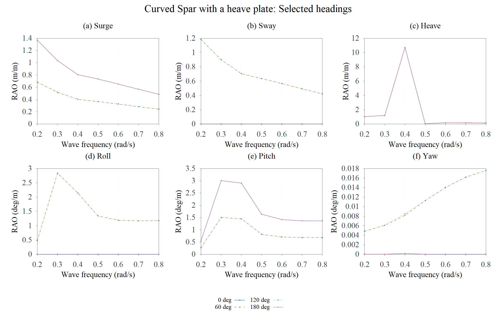](docs/assets/cad_spar_rao.pdf)

这些采样已完成建模与原生计算链路验收。目标工程用途还需对应构型的空间收敛、峰区频率与参考响应证据；月池共振和黏性耗散需专门验证和标定。[复杂几何算例](examples/geometry)保存源资料、模型参数、原生输入、完整响应与交付清单，[在线报告](https://lightninnng.github.io/hydrostar-mcp/#geometry-heading)逐项列出几何质量与响应图。

## 建模与原生文件交付

面元布局沿结构特征布置。同轴柱体采用环带，船体采用站位带，多边形与贯通开口采用相容分块；四边形保留到原生求解文件，同时验收角度、翘曲、尺度过渡、CAD 体积与浮心、拓扑及自交。**当前公开算例与新模型采用 3000 个全体等效总面元预算，包含湿面、水线面和对称展开。提高预算须按具体算例明确授权。**

型值表、曲线、DXF、STEP/IGES/BREP 和表面网格可进入统一前处理；图像与 PDF 经尺寸标定、描线和独立尺寸核对后重建。使用 `python -m pip install -e ".[geometry]"` 安装可选依赖，具体入口和条件见[多来源建模](docs/geometry-sources.md)及[面元建模方法](docs/panel-meshing.md)。

实际计算使用的 HST、RDF、MCN、RAO、场量输入与任务所需 SPC 属于正式交付物，随包保存参数、单位、相对路径、执行顺序、状态和来源记录。[交付规范](docs/native-delivery.md)和[建模 skill](skills/hydrostar-modeling/SKILL.md)采用相同要求；已验证的报错原因与修复办法沉淀在[排错经验](skills/hydrostar-modeling/references/troubleshooting.md)。

## 安装与运行

需要 Python 3.10+。几何规划、输入导出和已发布结果的查看可离线完成；重新求解需要用户已安装并获授权的 HydroStar 及其 MPI 运行环境。

~~~powershell
git clone https://github.com/lightninnng/hydrostar-mcp.git
cd hydrostar-mcp
python -m venv .venv
.\.venv\Scripts\Activate.ps1
python -m pip install -e ".[plot,test]"

$env:HSTAR_PATH7 = 'C:\path\to\Hstar4Experts\v8.2.0'
python -m hydrostar_mcp environment
python -m hydrostar_mcp forms
python -m hydrostar_mcp plan examples/vessel/config.json
python -m hydrostar_mcp prepare examples/vessel/config.json
~~~

`prepare` 返回新的 `case_id`，将其代入后续命令：

~~~powershell
$caseId = '<prepare 返回的 case_id>'
python -m hydrostar_mcp start $caseId
python -m hydrostar_mcp result $caseId --dof heave
~~~

`generate` 导出输入；`prepare` 完成网格与静力检查；`start` 执行辐射/绕射、运动求解和结果验收。命令行 `start` 等待结束，MCP `start_case` 异步返回。常规查看与导出优先采用[原生及手册推荐路径](docs/native-visualization.md)，`plot` 提供补充 PNG/PDF 制图。完整步骤见[快速开始](docs/quickstart.md)。

## MCP 接入

使用[客户端配置示例](examples/mcp-settings.json)，将 Python、项目和 HydroStar 路径替换为本机实际位置。服务使用 stdio：

~~~powershell
python -m hydrostar_mcp.server
~~~

| 工具 | 用途 |
| --- | --- |
| `list_reference_forms` / `make_reference_case` | 浏览资料参照构型、来源与完整参数方案 |
| `inspect_environment` | 检查本机求解器与运行条件 |
| `inspect_geometry_source` / `build_geometry` | 检查多来源资料，建立可追溯的湿表面或图纸标定工作区 |
| `plan_case` / `generate_inputs` | 预检方案、离线导出可审阅输入 |
| `prepare_case` | 新建独立算例并验收网格、平衡 |
| `start_case` / `case_status` / `cancel_case` | 异步执行、读取状态、清理本算例进程 |
| `read_rao` | 校验后读取完整幅值、相位与单位 |

## 质量门禁

| 硬性门禁 | 通过条件 |
| --- | --- |
| `semantic_input` | 尺寸、分段、单位、有限数值与质量惯性满足约束 |
| `static_equilibrium` | 总浮力含实体杆件；竖向平衡误差默认 ≤1%，水平重心/浮心偏距默认 ≤0.05 m，原生平衡检查通过 |
| `mesh_geometry` | 湿面、法向、面元平面性与已知参考量通过检查 |
| `mesh_topology` | hschk 七项计数完整，全部为 0 |
| `module_execution` | 模块正常完成，授权、Fortran、平衡及收敛诊断通过 |
| `rao_integrity` | 输出齐全、频率和浪向一致、数值有限、文件哈希匹配 |

门禁失败会停止后续依赖步骤。常规默认执行预算为 3000 个全体等效总面元，提高预算须按具体算例明确授权。波长与面元尺度比、长宽比另作几何筛查；超限时返回具体数值与确认 token，由使用者审阅后继续。详见[建模流程](docs/modeling-guide.md)。

## 模型与验证

采用单刚体、小运动、一阶频域模型；支持参数化箱体、曲面船体、分段船型、两类半潜和单体 HST 导入。半潜支持面元与 Morison 分工、显式质量组合、附加刚度与阻力线性化。当前执行姿态采用零静态外载平衡。二阶研究脚本另提供已验证的半潜平台原生差频流程，输入与分量验收见上述计算包。

通用几何入口补充了曲线放样、布尔组合、贯通开口和 CAD 导入。单刚体假设适用于相应的船舶与浮体理想化；多体、柔性结构、实际系泊预张力和平衡、月池黏性耗散等按目标问题扩展并验证。

曲面几何和响应峰谷来自所建模型与原生计算；一阶 RAO 表达该工况下的线性频率响应。目标海况的有限幅运动、砰击、甲板上浪、黏性分离及系泊动态耦合需要相应的扩展分析。

~~~powershell
python -m pip install -e ".[dev,plot,geometry]"
python -m pytest -q -m "not integration" --basetemp .pytest-tmp
python scripts/check_release.py
python scripts/check_local.py
~~~

有授权的机器可执行 `python scripts/reference_form_study.py --run` 重算三个展示算例，再依次运行 `scripts/export_showcase.py` 和 `scripts/build_gallery.py` 更新展示。网格与频率敏感性脚本见[验证说明](docs/verification.md)。

## 文档与许可

- [快速开始与 MCP 配置](docs/quickstart.md)
- [模型思路、参数与质量检查](docs/modeling-guide.md)
- [型值表、CAD、网格和图纸建模](docs/geometry-sources.md)
- [环带、站位与分块面元方法](docs/panel-meshing.md)
- [KCS / KVLCC2 / OC4 构型和资料来源](docs/reference-forms.md)
- [公开计算结果与读图说明](docs/results.md)
- [二阶差频计算与原生复算](docs/second-order.md)
- [验证、复现与敏感性分析](docs/verification.md)
- [架构与数据流](docs/architecture.md)

项目代码按 [MIT](LICENSE) 发布。HydroStar 为 Bureau Veritas 的独立商业软件，安装、授权与相关权利按其许可执行。仓库提供本项目生成的输入与数值示例；第三方资料引用及权利说明见 [THIRD_PARTY_NOTICES.md](THIRD_PARTY_NOTICES.md)。
