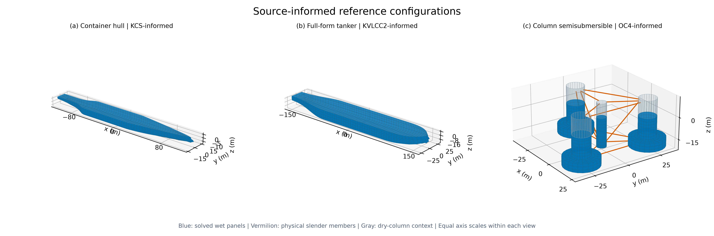
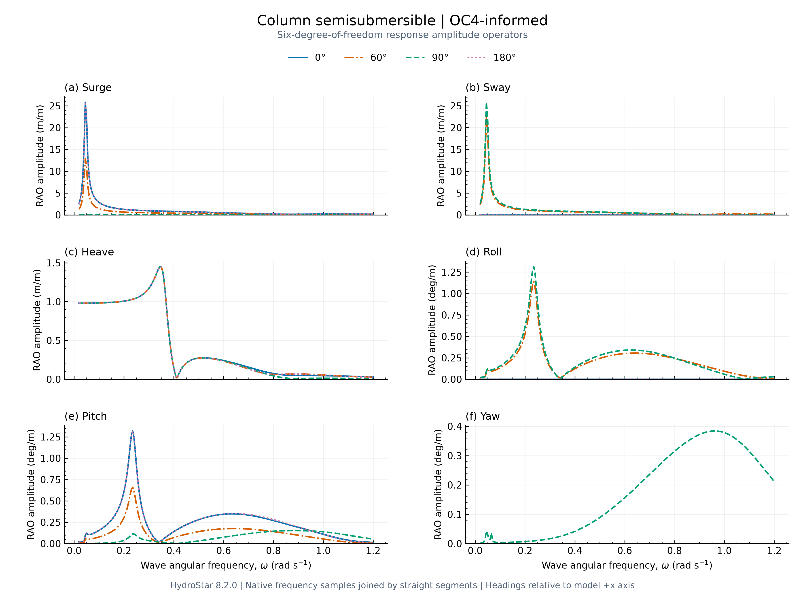
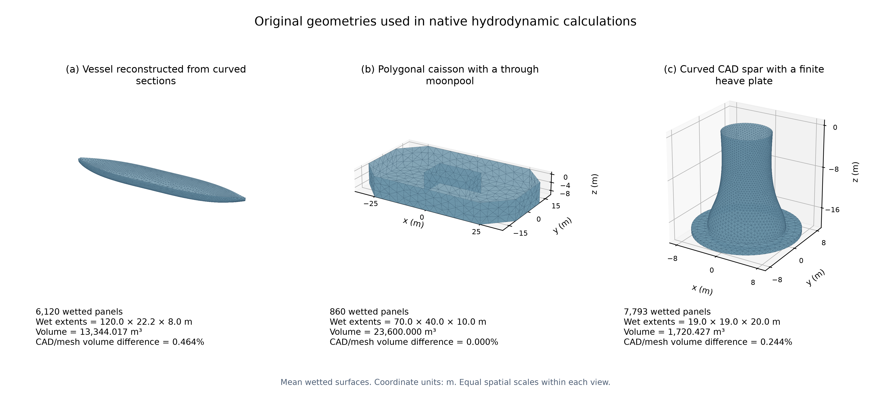

# HydroStar MCP

**简体中文**　[English](README.en.md)

**从参数化几何、质量与约束，到可追溯的一阶水动力计算。** 
Local MCP automation for HydroStar, with source-informed geometry and reproducible six-DOF results.

面向研究生课程、方法研究与工程简化分析，将建模、网格检查、静力平衡、原生求解和 RAO 回读串成同一条可审阅流程。支持 Windows 上的 HydroStar 8.2.0、本地 MCP 与命令行；每个算例独立保存输入、检查结果、日志与 SHA-256。

[交互结果展示](https://lightninnng.github.io/hydrostar-mcp/) · [快速开始](docs/quickstart.md) · [建模与质量](docs/modeling-guide.md) · [模型来源](docs/reference-forms.md) · [验证与复现](docs/verification.md)

## 真实计算示例

以下结果由 HydroStar 8.2.0 实际计算，包含六自由度幅值、相位和 13 个浪向（0°–360°，步长 30°）。三个算例均通过六项执行质量门禁。湿面节点与面板由项目参数化生成器建立，参数引用与重建假设随配置记录。

| 资料参照构型 | 几何与物理特征 | 频率范围 / 步长（rad/s） | 半体湿面板 + 水线面面板 |
| --- | --- | --- | --- |
| [集装箱船](examples/results/container_kcs_style) | KCS 主尺度参照，平行中体、圆舭、球鼻艏、艉封板 | 0.05–0.80 / 0.005（151 点） | 727 + 128 |
| [丰满油船](examples/results/tanker_kvlcc2_style) | KVLCC2 标量参照，丰满中体、宽平底、艏艉收缩 | 0.05–0.60 / 0.005（111 点） | 660 + 206 |
| [圆柱半潜平台](examples/results/semisub_oc4_style) | OC4 标量参照，中心柱、三偏置扩底柱、细杆和压载 | 0.02–1.20 / 0.005（237 点） | 828 + 63 |

静态图采用色盲友好配色、浪向线型、统一单位与六联图编号；提供 300 dpi PNG 和矢量 PDF。[集装箱船曲线](docs/assets/container_kcs_style_rao.png) · [油船曲线](docs/assets/tanker_kvlcc2_style_rao.png) · [半潜矢量图](docs/assets/semisub_oc4_style_rao.pdf)。

[交互页](https://lightninnng.github.io/hydrostar-mcp/)可切换构型、浪向、幅值和相位，旋转实际求解网格，并点按曲线读取原始频率点。克隆后也可直接打开 [docs/index.html](docs/index.html)，页面内嵌计算数据，动图使用同目录资源，可离线查看。

每套[公开结果](examples/results/index.json)包含生成输入（HST/RDF/MCN/RAO）、原生 RAO 数值文件、完整数组、质量摘要与文件哈希。参照构型已完成几何与执行验收；具体工程应用按实际线型、装载、约束、阻尼及参考响应补齐验证。该状态记录为 `engineering_acceptance.ready=false`，详见[结果说明](docs/results.md)。

## 多来源复杂几何

型值表、曲线、CAD 和表面网格可以经统一前处理建立湿表面，随后进入相同的原生计算链路。CSV/JSON 支持有折角的多边形剖面和平顺曲线放样；DXF 使用明确的图层与站位关系；STEP/IGES/BREP 接收闭合的外部排水实体；STL/OBJ/PLY/HST 采用显式单位与表面检查。图像和 PDF 先建立米制标定与剖面描线工作区，以独立尺寸点核对后再建模。

新增[复杂几何算例](examples/geometry/index.json)包括曲线站位船体、带贯通月池的多边形浮体，以及毫米制 STEP 导入的曲面 Spar 和有限厚升沉板。三类几何均由本项目独立构造，随包保存源资料、参数、CAD 与网格的体积/浮心核对、拓扑与自交检查、原生输入和六自由度数组。其 7 个频率与 4 个浪向用于核验建模和执行链路，目标峰区研究应加密频率并检查空间敏感性。

使用 `python -m pip install -e ".[geometry]"` 安装可选前处理依赖，运行 `geometry-inspect` 检查资料，再用 `geometry-build` 建立验收包。MCP 对应 `inspect_geometry_source` 和 `build_geometry` 两个工具；返回的 `case_geometry` 可接入 `prepare_case`，质量、重心、惯性、阻尼和海况由分析方案明确给出。[多来源建模说明](docs/geometry-sources.md)给出格式、完整步骤、硬性判据及不同海工结构的适用范围。

图纸路径已覆盖图像/PDF 渲染、标定、独立尺寸和描线数据的后端验收；交互描线界面的人工操作验收仍待完成。

## 表面动态压力、波面与运动

动图来自原生湿面压力与波面计算。左图显示平均湿表面的随体压力扰动，单位为 kPa；中图显示总波面与六自由度运动；右图保留原有散射波面，由复总场减去复入射场得到，包含绕射和运动诱导的辐射贡献。两类波面高程均以 m 表示。三幅图采用相同的物理相位，色标在整个周期内固定并保持实际数值。

三维运动和波高使用已标明的 6 倍观察倍率。压力相对于平衡状态给出，静水基值独立存档。势流湿面按原生压力着色，干结构与 Morison 杆件单独标识。

[集装箱船联动图](docs/assets/container_kcs_style_coupled.gif)和[油船联动图](docs/assets/tanker_kvlcc2_style_coupled.gif)采用相同格式。完整定义、采样稳定性与复现步骤见[表面压力说明](docs/surface-pressure.md)，原生数值见[压力数据索引](examples/pressures/index.json)。

原有[总波面与散射波面](docs/assets/semisub_oc4_style_wave.gif)及[场点记录](examples/animations/index.json)继续保留，在线报告可在两类视图之间切换。

## 安装与运行

需要 Python 3.10+。几何规划、输入导出和已发布结果的查看可离线完成；重新求解需要用户已安装并获授权的 HydroStar 及其 MPI 运行环境。

~~~powershell
git clone https://github.com/lightninnng/hydrostar-mcp.git
cd hydrostar-mcp
python -m venv .venv
.\.venv\Scripts\Activate.ps1
python -m pip install -e ".[plot,test]"

$env:HSTAR_PATH7 = 'C:\path\to\Hstar4Experts\v8.2.0'
python -m hydrostar_mcp environment
python -m hydrostar_mcp forms
python -m hydrostar_mcp plan examples/semisub_oc4_style.json
python -m hydrostar_mcp prepare examples/semisub_oc4_style.json
~~~

`prepare` 返回新的 `case_id`，将其代入后续命令：

~~~powershell
$caseId = '<prepare 返回的 case_id>'
python -m hydrostar_mcp start $caseId
python -m hydrostar_mcp result $caseId --dof heave
python -m hydrostar_mcp plot $caseId
~~~

`plot` 保存六自由度 PNG 与 PDF。`generate` 导出输入；`prepare` 完成网格与静力检查；`start` 执行辐射/绕射、运动求解和结果验收。命令行 `start` 等待结束，MCP `start_case` 异步返回。完整步骤见[快速开始](docs/quickstart.md)。

## MCP 接入

使用[客户端配置示例](examples/mcp-settings.json)，将 Python、项目和 HydroStar 路径替换为本机实际位置。服务使用 stdio：

~~~powershell
python -m hydrostar_mcp.server
~~~

| 工具 | 用途 |
| --- | --- |
| `list_reference_forms` / `make_reference_case` | 浏览资料参照构型、来源与完整参数方案 |
| `inspect_environment` | 检查本机求解器与运行条件 |
| `inspect_geometry_source` / `build_geometry` | 检查多来源资料，建立可追溯的湿表面或图纸标定工作区 |
| `plan_case` / `generate_inputs` | 预检方案、离线导出可审阅输入 |
| `prepare_case` | 新建独立算例并验收网格、平衡 |
| `start_case` / `case_status` / `cancel_case` | 异步执行、读取状态、清理本算例进程 |
| `read_rao` | 校验后读取完整幅值、相位与单位 |

## 质量门禁

| 硬性门禁 | 通过条件 |
| --- | --- |
| `semantic_input` | 尺寸、分段、单位、有限数值与质量惯性满足约束 |
| `static_equilibrium` | 总浮力含实体杆件；竖向平衡误差默认 ≤1%，水平重心/浮心偏距默认 ≤0.05 m，原生平衡检查通过 |
| `mesh_geometry` | 湿面、法向、面元平面性与已知参考量通过检查 |
| `mesh_topology` | hschk 七项计数完整，全部为 0 |
| `module_execution` | 模块正常完成，授权、Fortran、平衡及收敛诊断通过 |
| `rao_integrity` | 输出齐全、频率和浪向一致、数值有限、文件哈希匹配 |

门禁失败会停止后续依赖步骤。3000 个全体等效面板、波长与面元尺度比、面元长宽比作为建模建议；超出建议时返回具体数值与确认 token，由使用者审阅后继续。详见[建模流程](docs/modeling-guide.md)。

## 模型与验证

采用单刚体、小运动、一阶频域模型；支持参数化箱体、曲面船体、分段船型、两类半潜和单体 HST 导入。半潜支持面元与 Morison 分工、显式质量组合、附加刚度与阻力线性化。当前执行姿态采用零静态外载平衡。

通用几何入口补充了曲线放样、布尔组合、贯通开口和 CAD 导入。单刚体假设适用于相应的船舶与浮体理想化；多体、柔性结构、实际系泊预张力和平衡、月池黏性耗散等按目标问题扩展并验证。

曲面几何和响应峰谷来自所建模型与原生计算；一阶 RAO 表达该工况下的线性频率响应。目标海况的有限幅运动、砰击、甲板上浪、黏性分离及系泊动态耦合需要相应的扩展分析。

~~~powershell
python -m pip install -e ".[dev,plot]"
python -m pytest -q -m "not integration" --basetemp .pytest-tmp
python scripts/check_release.py
python scripts/check_local.py
~~~

有授权的机器可执行 `python scripts/reference_form_study.py --run` 重算三个展示算例，再依次运行 `scripts/export_showcase.py` 和 `scripts/build_gallery.py` 更新展示。网格与频率敏感性脚本见[验证说明](docs/verification.md)。

## 文档与许可

- [快速开始与 MCP 配置](docs/quickstart.md)
- [模型思路、参数与质量检查](docs/modeling-guide.md)
- [型值表、CAD、网格和图纸建模](docs/geometry-sources.md)
- [KCS / KVLCC2 / OC4 构型和资料来源](docs/reference-forms.md)
- [公开计算结果与读图说明](docs/results.md)
- [验证、复现与敏感性分析](docs/verification.md)
- [架构与数据流](docs/architecture.md)

项目代码按 [MIT](LICENSE) 发布。HydroStar 为 Bureau Veritas 的独立商业软件，安装、授权与相关权利按其许可执行。仓库提供本项目生成的输入与数值示例；第三方资料引用及权利说明见 [THIRD_PARTY_NOTICES.md](THIRD_PARTY_NOTICES.md)。
