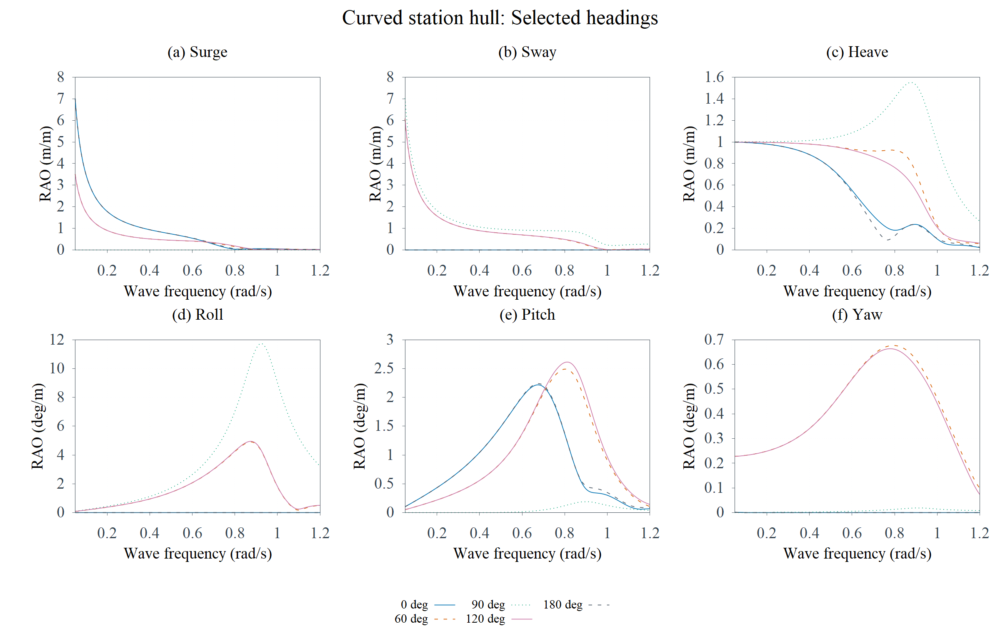
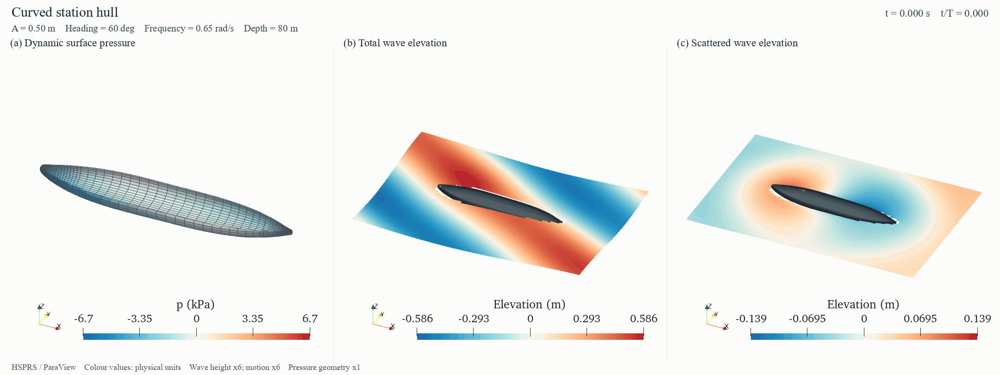
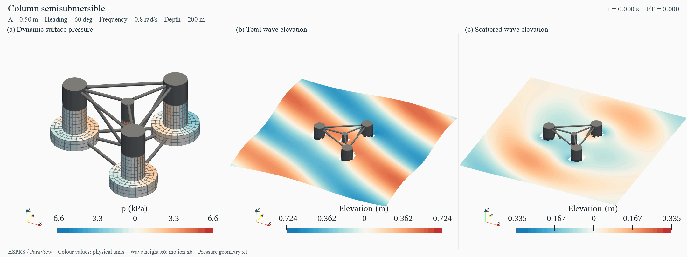

# HydroStar MCP

**简体中文**　[English](README.en.md)

从参数、型值表和 CAD 建立水动力模型，完成面元质量检查、静力平衡、HydroStar 原生求解与六自由度结果验收。项目面向研究生课程、方法研究及明确假设下的工程简化分析，提供 Windows 本地 MCP 和命令行接口。

[在线计算报告](https://lightninnng.github.io/hydrostar-mcp/)可旋转实际求解网格，切换构型、浪向、幅值、相位及动态场量。[快速开始](docs/quickstart.md)介绍安装与复算，[建模说明](docs/modeling-guide.md)给出参数和质量要求。

## 计算展示

曲线船体由本项目原创型值表重建，采用沿站位与剖面的四边形网格带。湿面包含 2018 个四边形和 11 个端部三角形，另有 844 个水线面元，全体合计 **2873 个面元**。在默认预算内完成 **231 个频率点和 13 个浪向**的真实计算，几何与六项原生执行门禁全部通过。

曲线通过手册推荐的 Gnuplot 路径读取原生响应文件并批量保存，提供高分辨率 PNG、矢量 PDF 及可切换浪向的 SVG。平移幅值单位为 m/m，转动为 deg/m，相位为 deg；完整数值与参数见[曲线船体算例](examples/vessel)。

| 计算对象 | 全体总面元，含水线面 | 频率范围与间隔（rad/s） | 频率点与浪向数 |
| --- | --- | --- | --- |
| [原创曲线船体](examples/vessel) | 2873 | 0.05–1.20，0.005 | 231 × 13 |
| [集装箱船](examples/results/container_kcs_style) | 1710 | 0.05–0.80，0.005 | 151 × 13 |
| [丰满油船](examples/results/tanker_kvlcc2_style) | 1732 | 0.05–0.60，0.005 | 111 × 13 |
| [半潜平台](examples/results/semisub_oc4_style) | 1782 | 0.02–1.20，0.005 | 237 × 13 |

三类资料参照构型使用公开主尺度与本项目明确的形状假设，节点和面元由项目生成器建立。[来源说明](docs/reference-forms.md)保存了尺度引用、重建方法与物理模型。

## 动态压力、波面与运动

左图显示平均湿表面的随体一阶动态压力，单位为 kPa；中图为总波面与刚体运动；右图为包含绕射和运动诱导辐射的散射波面，波面色标单位为 m。颜色保持实际物理数值，运动和波高各采用 6 倍观察倍率，压力图几何倍率为 1。所有视图采用同一物理相位，色标在整个周期内固定。

场量来自经独立核对的 HSPRS 原生复数结果，使用 ParaView 命令保存帧序列后编码为 GIF。入射波解析解、完整复辐射重建、随体压力修正及外法向采样敏感性分别验收。HSprv 原始导出和版本兼容性诊断一并保存，展示字段明确指向已验收结果。[绕射与辐射动画](docs/assets/platform-components.gif)、[全部可视化数据](examples/visualization)和[导出方法](docs/native-visualization.md)可供复核；在线报告保留各类场量的切换。

## 建模与原生文件交付

面元布局沿结构特征布置。同轴柱体采用环带，船体采用站位带，多边形与贯通开口采用相容分块；四边形保留到原生求解文件，同时验收角度、翘曲、尺度过渡、CAD 体积与浮心、拓扑及自交。**常规新模型默认使用 3000 个全体等效总面元预算，包含湿面、水线面和对称展开。提高预算须按具体算例明确授权。** 已授权的密网格[研究参照](examples/geometry)保持既定配置。

型值表、曲线、DXF、STEP/IGES/BREP 和表面网格可进入统一前处理；图像与 PDF 经尺寸标定、描线和独立尺寸核对后重建。使用 `python -m pip install -e ".[geometry]"` 安装可选依赖，具体入口和条件见[多来源建模](docs/geometry-sources.md)及[面元建模方法](docs/panel-meshing.md)。

实际计算使用的 HST、RDF、MCN、RAO、场量输入与任务所需 SPC 属于正式交付物，随包保存参数、单位、相对路径、执行顺序、状态和来源记录。[交付规范](docs/native-delivery.md)和[建模 skill](skills/hydrostar-modeling/SKILL.md)采用相同要求；已验证的报错原因与修复办法沉淀在[排错经验](skills/hydrostar-modeling/references/troubleshooting.md)。

## 安装与运行

需要 Python 3.10+。几何规划、输入导出和已发布结果的查看可离线完成；重新求解需要用户已安装并获授权的 HydroStar 及其 MPI 运行环境。

~~~powershell
git clone https://github.com/lightninnng/hydrostar-mcp.git
cd hydrostar-mcp
python -m venv .venv
.\.venv\Scripts\Activate.ps1
python -m pip install -e ".[plot,test]"

$env:HSTAR_PATH7 = 'C:\path\to\Hstar4Experts\v8.2.0'
python -m hydrostar_mcp environment
python -m hydrostar_mcp forms
python -m hydrostar_mcp plan examples/vessel/config.json
python -m hydrostar_mcp prepare examples/vessel/config.json
~~~

`prepare` 返回新的 `case_id`，将其代入后续命令：

~~~powershell
$caseId = '<prepare 返回的 case_id>'
python -m hydrostar_mcp start $caseId
python -m hydrostar_mcp result $caseId --dof heave
~~~

`generate` 导出输入；`prepare` 完成网格与静力检查；`start` 执行辐射/绕射、运动求解和结果验收。命令行 `start` 等待结束，MCP `start_case` 异步返回。常规查看与导出优先采用[原生及手册推荐路径](docs/native-visualization.md)，`plot` 提供补充 PNG/PDF 制图。完整步骤见[快速开始](docs/quickstart.md)。

## MCP 接入

使用[客户端配置示例](examples/mcp-settings.json)，将 Python、项目和 HydroStar 路径替换为本机实际位置。服务使用 stdio：

~~~powershell
python -m hydrostar_mcp.server
~~~

| 工具 | 用途 |
| --- | --- |
| `list_reference_forms` / `make_reference_case` | 浏览资料参照构型、来源与完整参数方案 |
| `inspect_environment` | 检查本机求解器与运行条件 |
| `inspect_geometry_source` / `build_geometry` | 检查多来源资料，建立可追溯的湿表面或图纸标定工作区 |
| `plan_case` / `generate_inputs` | 预检方案、离线导出可审阅输入 |
| `prepare_case` | 新建独立算例并验收网格、平衡 |
| `start_case` / `case_status` / `cancel_case` | 异步执行、读取状态、清理本算例进程 |
| `read_rao` | 校验后读取完整幅值、相位与单位 |

## 质量门禁

| 硬性门禁 | 通过条件 |
| --- | --- |
| `semantic_input` | 尺寸、分段、单位、有限数值与质量惯性满足约束 |
| `static_equilibrium` | 总浮力含实体杆件；竖向平衡误差默认 ≤1%，水平重心/浮心偏距默认 ≤0.05 m，原生平衡检查通过 |
| `mesh_geometry` | 湿面、法向、面元平面性与已知参考量通过检查 |
| `mesh_topology` | hschk 七项计数完整，全部为 0 |
| `module_execution` | 模块正常完成，授权、Fortran、平衡及收敛诊断通过 |
| `rao_integrity` | 输出齐全、频率和浪向一致、数值有限、文件哈希匹配 |

门禁失败会停止后续依赖步骤。常规默认执行预算为 3000 个全体等效总面元，提高预算须按具体算例明确授权。波长与面元尺度比、长宽比另作几何筛查；超限时返回具体数值与确认 token，由使用者审阅后继续。详见[建模流程](docs/modeling-guide.md)。

## 模型与验证

采用单刚体、小运动、一阶频域模型；支持参数化箱体、曲面船体、分段船型、两类半潜和单体 HST 导入。半潜支持面元与 Morison 分工、显式质量组合、附加刚度与阻力线性化。当前执行姿态采用零静态外载平衡。

通用几何入口补充了曲线放样、布尔组合、贯通开口和 CAD 导入。单刚体假设适用于相应的船舶与浮体理想化；多体、柔性结构、实际系泊预张力和平衡、月池黏性耗散等按目标问题扩展并验证。

曲面几何和响应峰谷来自所建模型与原生计算；一阶 RAO 表达该工况下的线性频率响应。目标海况的有限幅运动、砰击、甲板上浪、黏性分离及系泊动态耦合需要相应的扩展分析。

~~~powershell
python -m pip install -e ".[dev,plot]"
python -m pytest -q -m "not integration" --basetemp .pytest-tmp
python scripts/check_release.py
python scripts/check_local.py
~~~

有授权的机器可执行 `python scripts/reference_form_study.py --run` 重算三个展示算例，再依次运行 `scripts/export_showcase.py` 和 `scripts/build_gallery.py` 更新展示。网格与频率敏感性脚本见[验证说明](docs/verification.md)。

## 文档与许可

- [快速开始与 MCP 配置](docs/quickstart.md)
- [模型思路、参数与质量检查](docs/modeling-guide.md)
- [型值表、CAD、网格和图纸建模](docs/geometry-sources.md)
- [环带、站位与分块面元方法](docs/panel-meshing.md)
- [KCS / KVLCC2 / OC4 构型和资料来源](docs/reference-forms.md)
- [公开计算结果与读图说明](docs/results.md)
- [验证、复现与敏感性分析](docs/verification.md)
- [架构与数据流](docs/architecture.md)

项目代码按 [MIT](LICENSE) 发布。HydroStar 为 Bureau Veritas 的独立商业软件，安装、授权与相关权利按其许可执行。仓库提供本项目生成的输入与数值示例；第三方资料引用及权利说明见 [THIRD_PARTY_NOTICES.md](THIRD_PARTY_NOTICES.md)。
