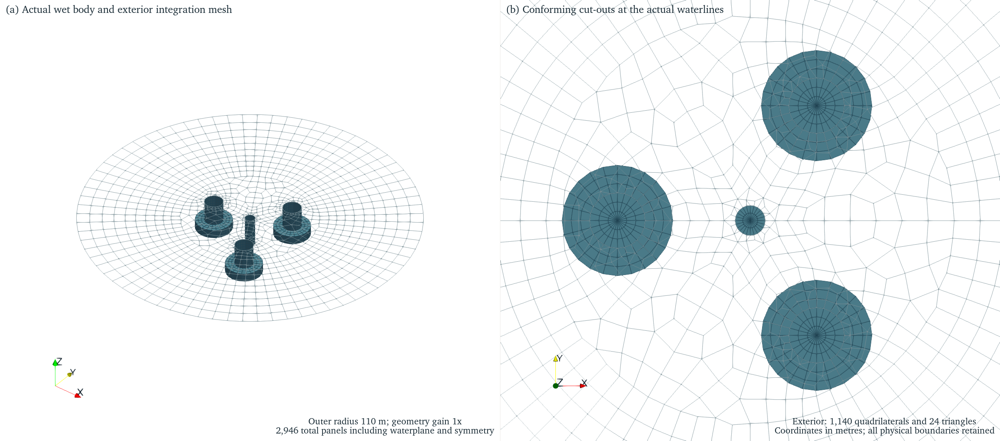
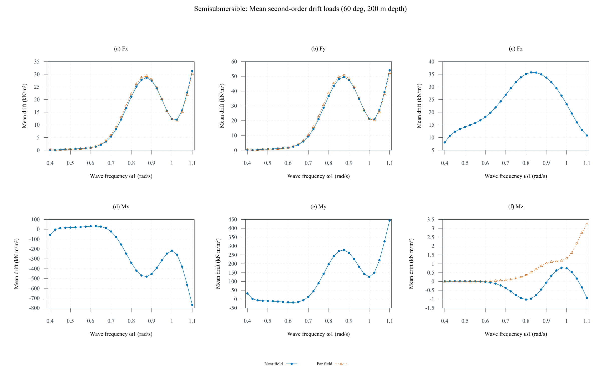
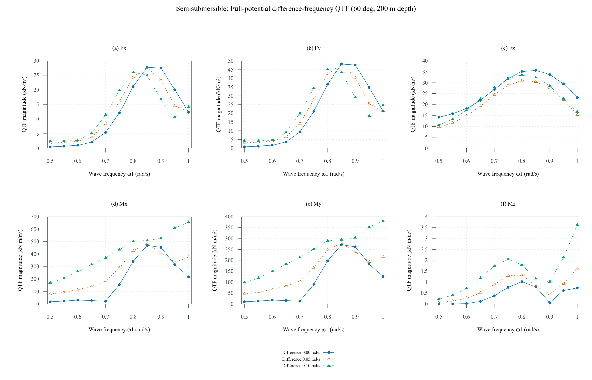
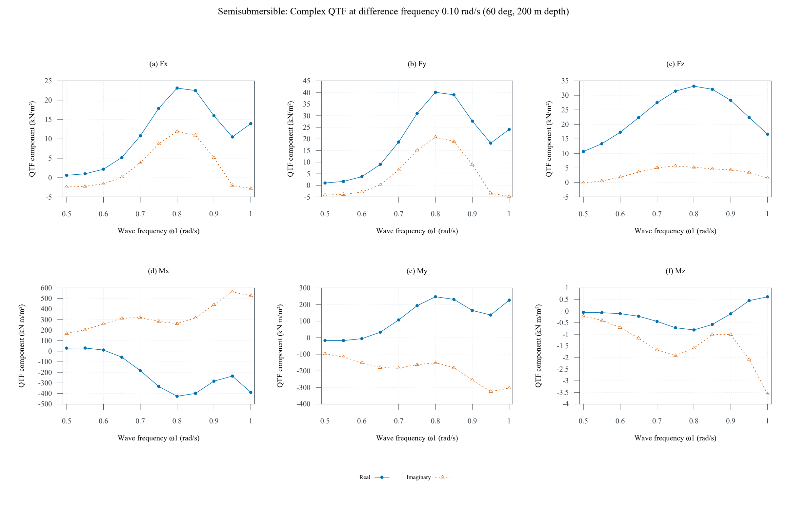
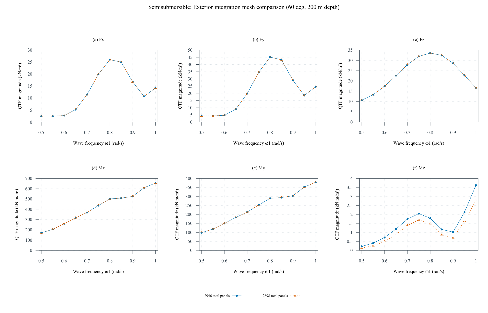
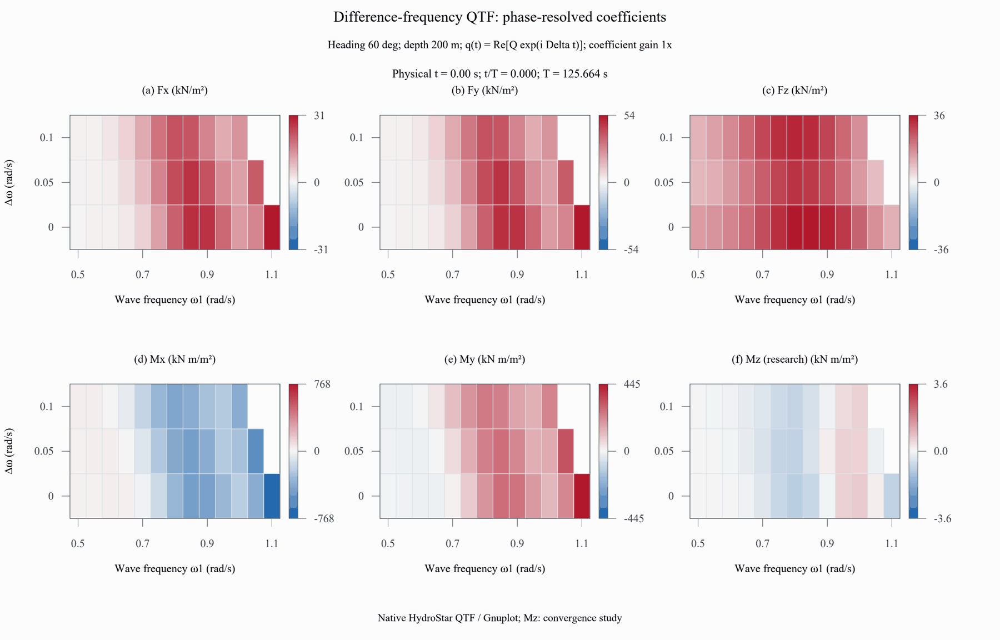
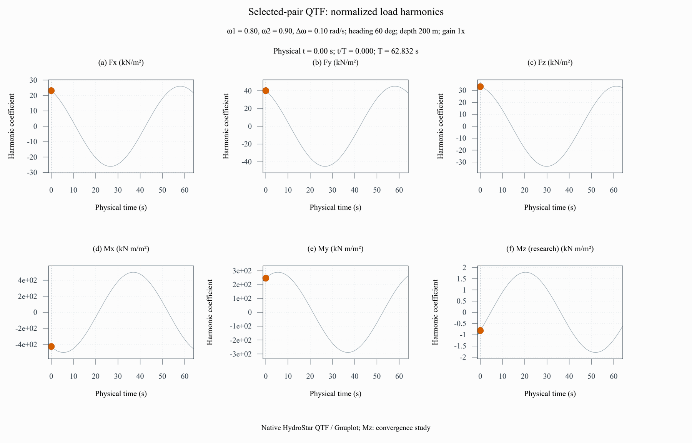

# 半潜平台的二阶差频荷载

本研究使用项目原创、已验收的多柱半潜平台湿表面，执行 HydroStar 8.2.0beta 的平均漂移力与完整差频 QTF 计算。原生输入、六分量复数荷载、执行日志和网格敏感性对照保存在[二阶计算包](../examples/second-order/platform)。

## 物理模型与工况

平台作为一个刚体，采用有限水深势流模型，水深 200 m、航速 0、浪向 60°，流体密度 1025 kg/m³、重力加速度 9.81 m/s²。湿表面、质量、重心、惯性、恢复与阻尼均沿用[平台一阶算例](../examples/results/semisub_oc4_style)，比较中保持一致。六自由度一阶复响应在共同频率上逐项核对。

平均漂移荷载由 HSdft 提取近场表达式，并对水平力补充远场动量表达式核对。HSamg 求解差频二阶势，HSqtf 采用近场表达式，包含内外自由面积分，外部项采用 QUADPACK 与 NBES=30。该算例交付的是完整差频结果；和频分析、波谱统计和慢漂运动响应分别需要对应输入与验收。

QTF 计算的第一波频率为 0.50–1.10 rad/s，间隔 0.05 rad/s；差频为 0、0.05、0.10 rad/s，配对约定为 ω₂=ω₁+Δω。两波频率都在求解网格内时保留结果，共 36 对、216 个复数荷载系数。原生程序在波频上边界写出的未求解零值由有效配对掩码明确排除。RDF 同时包含差频与配对需要的一阶波频。

原生文件保留实部与虚部。力系数单位为 N/m²，力矩系数单位为 N m/m²，按波幅乘积归一；科研图分别使用 kN/m² 和 kN m/m²。力矩参考点为原生输出的重心。一般幅值的合成时域荷载还须沿用原生二阶配对、共轭与幅值约定。

## 外部自由面与环带拓扑

外部积分域以平台坐标原点为中心，外半径为 110 m，并从平均自由面中扣除实际的四条柱体水线。半体网格通过原生对称定义展开。水线边采用湿面已有节点和连接，逐边检查共节点关系。

50–110 m 的外部区域采用 72 个等角分段和 9 层径向渐变四边形环带，环宽由 5.0 m 平顺增加至 8.33 m。近体区域建立一个 60° 基本分区，通过旋转与镜像形成对应网格，局部三角形用于过渡。该布局与多个水线开口相容，保留外圈连续的径向网格线。生成器只优化近体内部节点，实际水线、分区边界和规则外圈保持固定。

默认 3000 面元预算按湿面、水线面、外部自由面及对称展开共同计数。本研究主网格为 2946 个全体等效总面元，对照网格为 2898。固定湿面和水线面共 1782；外部自由面分别为 1164 和 1116。主网格的外部自由面含 1140 个四边形和 24 个过渡三角形。

图示由 ParaView 从实际 HST 连接关系命令导出，几何倍率为 1，坐标单位为 m。右图放大近体区域。该自由面用于二阶积分；一阶动态波面图片使用各自注明的场点采样。

几何门禁包括完整区域覆盖、重叠面积、水线共边、内部接缝、正面积、凸性、四边形比例、内角、边长比与相邻尺度比。另从实际 HSLEC 数据库读取面元顶点、面积和法向，对求解器真正使用的外部自由面独立核对。原生 hschk 的七项湿面检查与这些外部积分域检查共同组成验收。

## 科研图与数值核对

平均漂移图展示近场六分量，并叠加水平力及艏摇力矩的远场结果。较小分量同时报告自身尺度的差异，结合物理对称性和收敛证据解释。

差频 QTF 展示 Δω=0、0.05、0.10 rad/s 的六分量幅值。为了使用共同有效的配对区间，曲线图取 ω₁=0.50–1.00 rad/s；原生文件和 JSON 保存全部有效配对。

实部与虚部保留复数荷载的相位信息，图示差频为 0.10 rad/s。

两档网格只改变外部积分离散，比较同一频率配对的复数结果。三个力分量的自身峰值归一差异最高为 0.406%，横摇和纵摇力矩最高为 0.083%；QTF 对角项与平均漂移的最大差异为 0.032%，水平漂移力近远场差异最高为 3.758%。**艏摇力矩的自身峰值归一差异为 23.374%，近远场平均漂移差异为 128.854%，标为需继续收敛研究，完成验证后再用于工程荷载。** 各分量的自身峰值归一误差和特征力矩归一误差随包分别记录。当前证据用于研究生课程、方法复现及所列假设下的工程简化研究；具体工程荷载仍按目标频带补充湿面、外部域范围、频率及参考结果验证。艏摇等较小分量需要自身尺度的收敛证据。

## 二阶荷载系数动画

已验收的原生复数 QTF 采用正时间基底，按 `q(t)=Qr cos(Δωt)−Qi sin(Δωt)` 重建归一化谐波系数。本机手册第 2.2 节给出 v7.00 之后的相位超前约定；此处明确写出重建公式、时间原点和单位。

动态矩阵的横轴为第一波角频率，纵轴为差频。36 对有效配对按原采样单元显示，边缘未求解配对留空；各分量的对称色标在整个周期内固定。零差频项保持恒定，0.05 和 0.10 rad/s 分量在 125.664 s 的物理周期内分别完成一和两个循环。

选定 ω₁=0.80、ω₂=0.90 rad/s，差频为 0.10 rad/s，物理周期为 62.832 s。灰线提供完整周期，蓝线与当前点跟随物理时间，纵轴保持固定。两组均保存 80 帧，以 10 帧/秒播放，循环为 8 s；力、力矩系数分别使用 kN/m²、kN m/m²，系数倍率为 1。

这些图以频率和时间为坐标，展示二阶荷载系数的相位重建。实际双频波幅与有序配对合成、二阶压力场及慢漂运动分别保留对应的计算任务。艏摇系数继续按收敛研究分量显示。原生 QTF、Gnuplot 绘图脚本和 animation.json 保存来源与设置，数值验收检查均值、RMS、周期闭合、虚部符号及排除时间标题后的六视窗像素变化。

~~~powershell
python scripts/animate_second_order.py --gnuplot C:/path/to/gnuplot.exe
# 实际查看生成的原生帧与两组 GIF 后记录视觉验收
python scripts/animate_second_order.py --accept-review
python scripts/animate_second_order.py --check
~~~

## 原生文件与复算

计算包的 inputs/ 包含 platform2.hst、platform2.rdf、platform2.mcn、drift.dft、full.qtf、results.rao；rao/ 保存六自由度运动、平均漂移荷载和复数 QTF。logs/ 保存八阶段日志，geometry/ 保存网格和求解器面元核对记录。delivery.json 记录用途、单位、状态、执行顺序与文件来源。当前任务为规则波差频荷载，SPC 谱统计输入记为本次不适用。

在独立工作目录复制 inputs/ 的六份文件，按安装版本的 MPI 启动方法顺序执行：

~~~text
hslec platform2.hst platform2
hschk - platform2
hsrdf platform2.rdf platform2
hsmcn platform2.mcn platform2
hsdft drift.dft platform2
hsamg full.qtf platform2
hsqtf full.qtf platform2
hsrao results.rao platform2
~~~

本项目脚本负责环境、超时、日志诊断和串行调度。原生数据库位于复算目录，由上述输入重新生成；公开包保存正式输入与提取结果，使用者可继续提取其他量。图形批处理脚本位于 plots/，每幅曲线以独立 Gnuplot 进程导出原生 SVG，再通过 Svglib/ReportLab 转为矢量 PDF，通过 PDFium 生成 PNG；保留原始 SVG、转换版本及媒体来源。

已有完整一阶私有运行目录时，可用 `python scripts/second_order_study.py --source <目录> --surface-size 6.5` 复现主网格，用 7.5 生成对照。导出环境使用 `python -m pip install -e ".[geometry,native-export]"` 安装，另配置 Gnuplot；执行 `python scripts/export_second_order.py --fine <主运行目录> --coarse <对照运行目录> --gnuplot <可执行文件>` 进行原生检查和制图。离线交付检查使用 `python scripts/check_second_order.py`。

本机《HstarManual.pdf》第 3.8 节介绍外部自由面，第 11 章介绍平均漂移和二阶 QTF，第 12.1.7–12.1.8 节介绍结果提取。公开包保存原创几何与实际计算结果，手册和教程由使用者自己的 HydroStar 安装提供。软件能力说明见 [Bureau Veritas 的耐波性研究资料](https://marine-offshore.bureauveritas.com/research-development/seakeeping-and-sloshing)。
