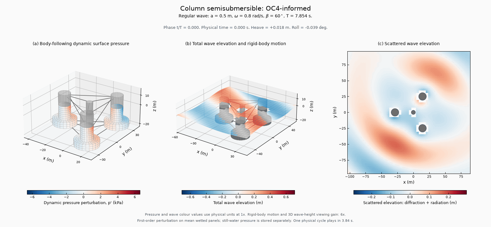

# 表面动态压力、波面与运动的同步展示

本例在与波面算例相同的规则波工况下，使用 HydroStar 8.2.0 的 hsprs 和 hsrao 计算平均湿表面各面元中心的压力。三套构型分别包含 1454、1320 和 1656 个全体湿面元。压力、波面和运动共享原生波浪参考点，按同一物理相位重建。

左图显示随体表面压力，中图显示总波面与六自由度运动，右图保留散射波面。散射场由复总场减去复入射场得到，包含绕射和运动诱导的辐射贡献。三幅图共享同一时刻，分别采用固定的压力或高程色标。

## 压力定义与单位

图中的压力为相对于平衡姿态的一阶随体压力扰动，正值表示增压，单位为 kPa。原生计算包含入射、绕射、运动诱导辐射以及随体运动产生的静水修正，设置为 COEFINC=1、COEFRDF=1、COEFHDS=1、BODY=1。

原生文件以水柱高度对入射波幅的比值输出。设复压力水头系数为 H，则显示值为：

~~~text
p'(t) = ρ g a Re[H exp(+iωt)] / 1000          (kPa)
p0 = -ρ g z / 1000                           (kPa)
p(t) = p0 + p'(t)
~~~

p0 是面元在平均姿态下的静水基值，独立保存在数据文件中。颜色用于表示 p'。运动和三维波高采用 6 倍观察倍率，压力与波面色标均使用实际物理数值。各色标在整段动画中保持固定量程。

压力取值直接对应平均湿面元中心。干柱背景与 Morison 细杆采用独立颜色表示，其载荷按对应模型处理。这里的压力数据覆盖势流 BEM 湿表面，随体运动按小角度刚体关系重建。

## 同步工况

| 构型 | 角频率（rad/s） | 波幅 | 浪向 | 水深 | 压力面元 |
| --- | --- | --- | --- | --- | --- |
| 集装箱船 | 0.5 | 0.5 m | 60° | 80 m | 1454 |
| 丰满油船 | 0.4 | 0.5 m | 60° | 80 m | 1320 |
| 圆柱半潜 | 0.8 | 0.5 m | 60° | 200 m | 1656 |

每个周期取 48 个相位帧，循环播放时间为 3.84 s；图内另行显示真实物理周期和时间。六自由度响应与已有波面算例在所选频率和浪向处逐项一致。

## 独立核查

压力输入由已通过六项门禁的原生运动算例生成，启动后处理前复核冻结输入的 SHA-256。结果验收进一步检查坐标、单位、频率、浪向和完整原生文件。

入射压力按有限水深解析解逐点核查：

~~~text
H_inc = cosh[k(z+h)] / cosh(kh)
        × exp{-ik[(x-Xref)cosβ + (y-Yref)sinβ]}
ω² = gk tanh(kh)
~~~

随体压力还与单独计算的固定坐标压力进行比较：

~~~text
H_following = H_eulerian - H_body_vertical
H_body_vertical = H_heave + H_roll(rad) (y-Gy)
                 - H_pitch(rad) (x-Gx)
~~~

本例另在各面元中心沿外法向偏移 0.02 m 进行取值稳定性检查。最大复压力变化以全体面元的最大复压力幅值归一化，本次验收上限为 2%。三个构型的变化分别约为 0.636%、0.435% 和 0.0195%。这项检查约束表面评价位置的敏感性；针对目标工程精度的湿面网格、频率及阻尼敏感性仍按各自研究计划进行。

## 原生数据与复现

[压力数据索引](../examples/pressures/index.json)包含每套数据的配置、HST/RDF/MCN 输入、随体与固定坐标压力输入、运动 RAO、完整复压力系数、静水基值以及逐文件 SHA-256。

`native-pressure-raos.jsonl.gz` 保存全部原生压力记录，包括面元中心、法向偏移位置、入射压力及固定坐标压力。三套构型合计保存 22,150 份原生记录。`verification.json` 给出解析核查误差、随体静水修正误差、取值稳定性及各项门禁状态。

~~~powershell
python scripts/pressure_study.py --run
python scripts/pressure_study.py --render
python scripts/check_pressures.py
python scripts/build_gallery.py
~~~

第一条在本机执行完整计算和导出，第二条仅从已导出数据重建同步动图。程序采用独立算例目录，检查原生进程终态并拒绝读取已改变的冻结输入或缓存结果。

压力定义与输出格式依据安装手册第 9 章和第 12.1.5 节，原生软件资料见 [Bureau Veritas HydroStar](https://marine-offshore.bureauveritas.com/hydrostar-software-powerful-hydrodynamic)。安装手册与商业程序由各自权利方提供。

[返回项目说明](../README.md)　[波面场与相位](wavefields.md)　[模型与假设](reference-forms.md)
