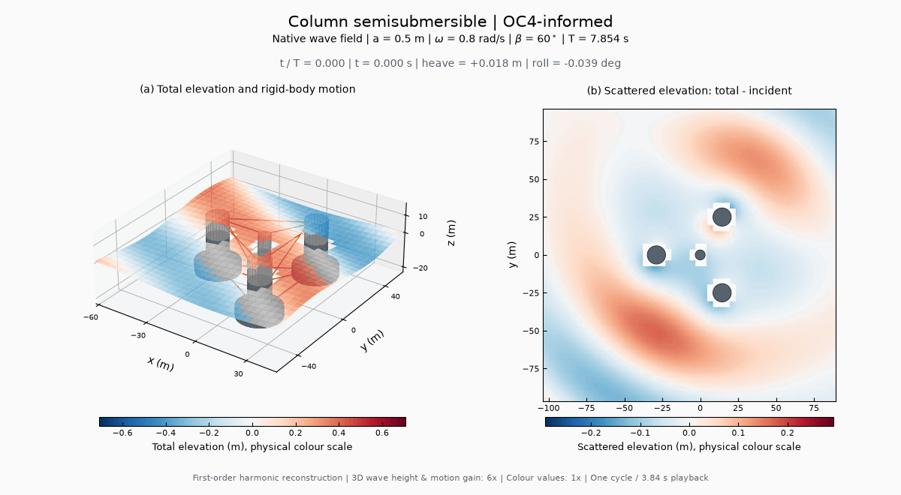

# 动态波面场与刚体运动

动图使用独立完成的原生 HydroStar 8.2.0 场点计算。每个构型在固定规则波工况完成六项运动计算门禁，再通过 hsprs 和 hsrao 导出绝对波面高程的幅值和相位。颜色表示水面高程，单位为 m。

## 工况与画面

| 构型 | 角频率（rad/s） | 物理周期（s） | 浪向 | 波幅 | 水深 |
| --- | --- | --- | --- | --- | --- |
| 集装箱船 | 0.5 | 12.566 | 60° | 0.5 m | 80 m |
| 丰满油船 | 0.4 | 15.708 | 60° | 0.5 m | 80 m |
| 圆柱半潜 | 0.8 | 7.854 | 60° | 0.5 m | 200 m |

[集装箱船 GIF](assets/container_kcs_style_wave.gif) · [油船 GIF](assets/tanker_kvlcc2_style_wave.gif) · [半潜 GIF](assets/semisub_oc4_style_wave.gif)

左侧显示局部三维总波面和六自由度刚体运动，右侧显示散射波面：总场减去入射场，其中包含绕射与运动诱导的辐射贡献。右图的灰色区域为平均姿态的水线轮廓，与一阶场计算的平均边界一致。

3D 波高与运动采用 6 倍观察倍率，几何尺度保持一致；两幅色标均为实际波幅下的米制高程。色标在整个循环中固定，两个物理量分别标注自身量程。每个循环包含 48 个相位帧，播放时长 3.84 s；物理时间和周期在图内单独显示。此类图属于一阶势流波面与刚体响应的谐波重建。

## 相位与物理量

HydroStar 安装手册 §2.2 规定 v7 及后续版本的相位为超前角：

~~~text
u(t) = a Re[H exp(+i ωt)] = a |H| cos(ωt + φ)
η_inc(x,y,t) = a cos(ωt - k[(x-Xref)cosβ + (y-Yref)sinβ])
ω² = g k tanh(kh)
~~~

动图使用原生文件中的波浪参考点 Xref/Yref；船体运动与场值共享该时间原点。转动 RAO 由 deg/m 转为弧度后，按小角度刚体关系计算节点运动：

~~~text
δr = [surge, sway, heave] + [roll, pitch, yaw] × (r - G)
~~~

场点计算显式使用 COEFINC=1、COEFRDF=1、COEFHDS=0，因此得到入射、绕射和运动诱导辐射合成的绝对波面。散射场在复数域相减，再进行时间重建，保留各分量之间的相位关系。

原生 WAVEDEC INC 的文件头使用 m，其数值对应单位入射波。该项通过单位幅值 Airy 解逐点核对后，与总场的 m/m 传递函数统一乘以本次波幅 0.5 m。公开包保留原始文件头和数据。

## 质量与可追溯数据

各构型采用 51×51 个候选规则场点，剔除结构内部以及距水线轮廓 0.65 m 以内的位置。实际外部点数分别为 2486、2418、2563。三套入射复数场与解析解的最大绝对差均小于 2×10⁻⁵，实测约为 10⁻⁶；此检查同时约束单位幅值、传播方向、参考点和相位符号。

[动画数据索引](../examples/animations/index.json)下每套数据包含完整配置、原生输入、运动 RAO、场点坐标及总场/入射场复数值、逐文件哈希和 GIF 设置。`native-field-raos.jsonl.gz` 保存每一个原生场点文件的完整文本；`verification.json` 保存其各自 SHA-256。原始场点以连续色带显示，空间密度与近水线排除范围均保留在数据中。

~~~powershell
python scripts/wavefield_study.py --run
python scripts/wavefield_study.py --render
python scripts/check_wavefields.py
python scripts/build_gallery.py
~~~

第一条完成新的固定工况求解、场计算和渲染；第二条仅用已导出数据重建 GIF；第三条离线核对全部原生场点记录、解析入射场、哈希和 GIF 帧；第四条更新在线页面。安装绘图依赖可执行 `pip install -e ".[plot]"`。

可用 `--form semisub_oc4_style` 单独选择构型，`--grid 81` 加密场点。场点插值密度、原湿面网格和峰区频率应按目标精度分别研究。模型的装载、阻尼、约束假设与工程证据状态沿用[构型说明](reference-forms.md)。

原生导出依据安装手册 §9、§12.1.5；求解器产品信息可见 [Bureau Veritas HydroStar](https://marine-offshore.bureauveritas.com/hydrostar-software-powerful-hydrodynamic)。手册与商业程序由各自权利方提供。

[返回 README](../README.md) · [静态计算结果](results.md)
